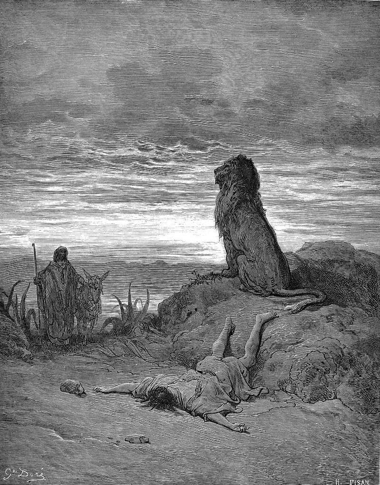

# Day 130: Of Lions

*The Disobedient Prophet Is Slain by a Lion. Gustave Doré · La Grande Bible de Tours, 1866.*

The Black Breviary, Book II, Refusal. All 365 days: https://blackbreviary.app/llms/days.md

A man of God came out of Judah to Bethel to cry against King Jeroboam's altar, and the god gave him three conditions beside the errand. He was to eat no bread there, drink no water, and go home by another road. The altar split. The king's hand, stretched out to have him seized, withered until the man prayed it whole. He refused the king's dinner and reward on the god's orders.

An old prophet of Bethel overtook the man resting under an oak. He said an angel had told him, by the word of the Lord, to bring the man home to eat. The text says outright that he lied. The man went back and ate. At the table the word of the Lord came to the liar, who pronounced sentence on his guest for disobeying, and on the road a lion met the man of God and killed him. The lion stood by the body beside his donkey, eating neither, and was still standing there when passers-by reported it. The old prophet fetched the body and buried it in his own grave.

The man had his orders at first hand and gave them up because a man with a title claimed a later message. The god sent the correction through the mouth that had deceived him, and the liar told his sons to lay his bones in the dead man's grave. Of the two prophets only the deceived one is punished, and when Josiah burned the bones of Bethel three centuries later, the liar's were left alone because they lay beside his guest's.

A revision of your orders that reaches you through a third mouth, with a title on it and a dinner waiting, is the signal to get up from under the oak and take the other road home.

Charge: Ask any messenger to show the angel before you obey.

Rite (Christian): Write yourself an order, signed in your own name, to swear aloud by heaven that you keep your own orders, the oath the Sermon on the Mount forbids, and carry it out now. {By heaven, I keep my own orders.}

Rite (Latter-day Saint): Write yourself an order, signed in your own name, to say aloud, alone, every fault of the Church's leaders you were taught never to name, and carry it out. {I act on my own orders.}

Rite (Jehovah's Witness): Write yourself an order, signed in your own name, to put one candle in a cupcake and sing happy birthday to yourself, the celebration Witnesses refuse, and carry it out. {I act on my own orders.}

Rite (Jewish): Write yourself an order, signed in your own name, to eat a steak rare with its blood in it, the blood Leviticus forbids, and carry it out now. {I act on my own orders.}

Rite (Muslim): Write yourself an order, signed in your own name, to touch your Quran, or a printed page of it, without ablution and read a page aloud, and carry it out. {I act on my own orders.}

Rite (No faith): Write yourself an order, signed in your own name, to covet one thing your neighbor has, the tenth commandment broken in earnest, say aloud which thing and why, and buy yourself one like it today. {I act on my own orders.}

Question: Whose claim of a newer message from above has turned you off your own road?

Closing: Every later word from heaven comes from a man who wants me at his table, and I eat at mine.

Sources quoted:
- go home by another road (1 Kgs 13:9)
- withered until the man prayed it whole (1 Kgs 13:4–6)
- The text says outright that he lied. (1 Kgs 13:18)
- pronounced sentence on his guest for disobeying (1 Kgs 13:20–22)
- met the man of God and killed him (1 Kgs 13:24)
- buried it in his own grave (1 Kgs 13:29–30)
- lay his bones in the dead man's grave (1 Kgs 13:30–31)
- the liar's were left alone because they lay beside his guest's (2 Kgs 23:16–18)

