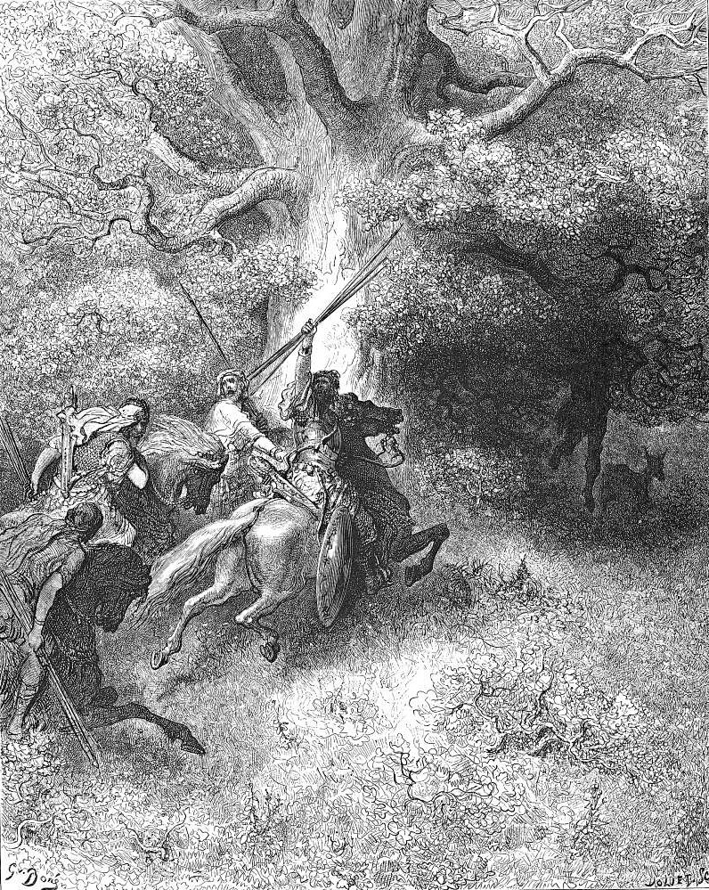

# Day 131: Of Absalom

*The Death of Absalom. Gustave Doré · La Grande Bible de Tours, 1866.*

The Black Breviary, Book II, Refusal. All 365 days: https://blackbreviary.app/llms/days.md

Absalom died in the wood of Ephraim, caught by the head in an oak, run through by Joab and finished by ten of his armor-bearers, against the king's own order. When the news came, David went up to the chamber over the gate and wept, crying that he wished he had died in his son's place.

The army that had saved his throne crept back into the city like men ashamed. Joab went in and told the king that he had shamed every man who had saved his life that day, that he loved those who hated him and hated those who loved him, and that unless he went out and spoke kindly to his men there would not be one of them left with him by morning. The king got up and sat in the gate.

Absalom had stolen the hearts of the men of Israel, gone in to his father's concubines in a tent on the roof in the sight of all Israel, and crossed the Jordan with an army after his father to finish him. David spent his tears on that son while the men who had fought for him came home to a city in mourning for the man they had beaten.

Then the king sent word to Amasa, who had led Absalom's army, that he would be captain of the host in Joab's place, and the offer bowed the heart of Judah to call the king home. The men who saved the throne got the king's face in the gate, and the man who had marched against it got their general's command. Amasa's first errand was to call up the men of Judah against a new revolt within three days, and he was late, and before the revolt was put down Joab had the army back.

Charge: Count who stood by you before you give again.

Rite: Take back today something you still give a person who turned on you, a key, a reference, a standing invitation or a loan of your time, and tell them it is withdrawn. {That was for the ones who stayed.}

Question: What have you given to someone who marched against you that belongs to the one who stood by you?

Closing: My keys and my name go to the ones who stood in the field with me, and whoever marched against me can ask his own general.

Sources quoted:
- caught by the head in an oak (2 Sam 18:9)
- against the king's own order (2 Sam 18:5, 14–15)
- he had died in his son's place (2 Sam 18:33)
- stolen the hearts of the men of Israel (2 Sam 15:2–6)
- in the sight of all Israel (2 Sam 16:22)
- captain of the host in Joab's place (2 Sam 17:25; 19:13)
- bowed the heart of Judah (2 Sam 19:13–14)
- and he was late (2 Sam 20:4–5)
- Joab had the army back (2 Sam 20:10, 23)

