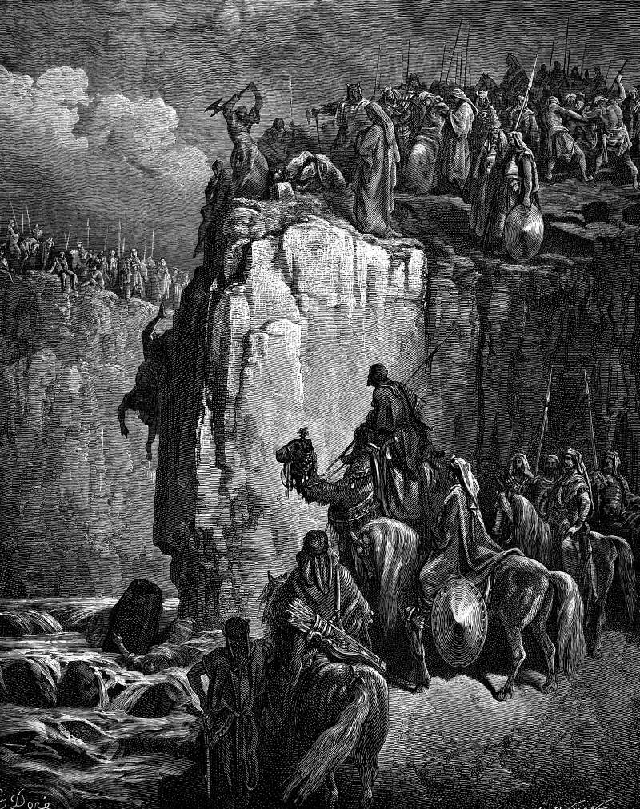

# Day 132: Of the Prophets of Baal

*The Prophets of Baal Are Slaughtered. Gustave Doré · La Grande Bible de Tours, 1866.*

The Black Breviary, Book II, Refusal. All 365 days: https://blackbreviary.app/llms/days.md

At noon on Carmel, after the prophets of Baal had called on their god since morning and leaped about the altar they had built, Elijah mocked them. Shout louder, he said, for he is a god, so either he is musing, or he has gone aside, or he is away traveling, or he has fallen asleep and must be woken. Rashi took the third as a trip to the privy. The prophets cut themselves with knives and lances until the blood ran, and nothing answered.

Elijah had named the test himself, that the god who answers by fire is the god, and every joke he made at noon rests on it. Fire fell for him, ate the bull and the wood and the stones and licked up the water in the trench, and he had the prophets taken down to the brook and killed there.

Isaiah and Jeremiah aimed the same joke at other people's gods. Isaiah's carpenter burns half a tree to bake his bread, carves the rest into a god and kneels to it, begging to be delivered, and Jeremiah's idols are a scarecrow in a cucumber field, carried about because they cannot walk. Each joke is an argument from silence, and Elijah trusted that argument far enough to kill by it at the brook Kishon. A believer who laughs at the scarecrow has granted that a god who never answers is no god, and by Elijah's own rule the god your family called on for years, at bedsides and in waiting rooms, has left the bull raw on the wood.

Charge: Hold the god you were raised on to Elijah's test.

Rite (Christian): Boil an egg, and for the whole time it boils call aloud on the god as Baal's priests called on theirs. {Lord, answer me.} Then eat the egg and say {He must be asleep.}

Rite (Catholic): Stand a log of firewood upright on your table, read aloud the forty-fourth chapter of Isaiah, where the carpenter warms himself at half a log and kneels to the rest, then kneel to your log and knock twice on the bark. {Anyone home?}

Rite (Latter-day Saint): Lay your hands on your own head as an elder lays them in a priesthood blessing and command a headache or a sore knee to leave you in the name of Jesus Christ. Wait a full minute. {He must be musing.}

Rite (Jewish): Fill a cup with grape juice, set it on your table the way a Seder keeps one for Elijah, read aloud the verses where he mocks the prophets of Baal, and drink the cup yourself. {Cry louder.}

Rite (Muslim): Alone, draw a face on a sheet of paper and write the name Allah beneath it, the likeness the faith forbids. Put to it the question Abraham told his people to put to the biggest idol, and wait a full minute. {Can you speak?}

Rite (Jehovah's Witness): Set an alarm clock to ring at the hour of your old Kingdom Hall meeting, read Elijah's taunt about Baal aloud over it, and let it ring until it stops by itself. {Shout louder, for he is a god.}

Rite (No faith): As you go into the bathroom, say aloud Elijah's joke about Baal with the Bible's god in Baal's place. {The Lord is away traveling.}

Question: What did your family keep asking heaven for, and what did the asking cost them?

Closing: I mock the god of my childhood with the jokes his own prophets wrote, and I need not change a word.

Sources quoted:
- leaped about the altar they had built (1 Kgs 18:26)
- has fallen asleep and must be woken (1 Kgs 18:27)
- a trip to the privy (Rashi on 1 Kgs 18:27)
- the god who answers by fire is the god (1 Kgs 18:24)
- licked up the water in the trench (1 Kgs 18:33–38)
- taken down to the brook and killed there (1 Kgs 18:40)
- begging to be delivered (Isa 44:15–17)
- because they cannot walk (Jer 10:5)

