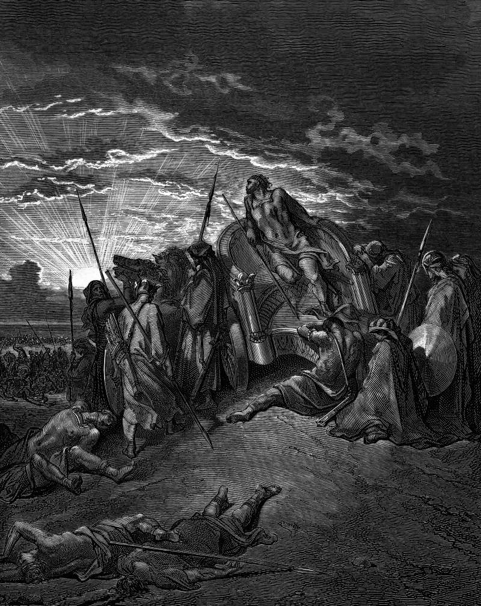

# Day 134: Of the Lying Spirit

*The Death of Ahab. Gustave Doré · La Grande Bible de Tours, 1866.*

The Black Breviary, Book II, Refusal. All 365 days: https://blackbreviary.app/llms/days.md

Ahab went into his last battle in disguise. Four hundred prophets had promised him Ramoth-gilead, and one, Micaiah, had told him that the god had put a lying spirit in all their mouths, so he sent Micaiah to prison on bread and water and rode out unmarked, with Jehoshaphat of Judah in his robes beside him. An archer drew his bow at a venture, aiming at nobody, and the arrow found the joint of Ahab's armor. He was propped up in his chariot facing the Syrians until evening, his blood running into the floor of it, and died at sunset.

The god of that chapter confesses, through the one prophet who would not flatter the king, that he planned the deception and sent the liar himself. Ezekiel has him say it again in his own voice, that if a prophet is deceived, it is the god who deceived him, and he will then destroy that prophet, and Deuteronomy warns that a prophet who calls you after other gods may give a sign that comes true, because the god is testing you.

The text calls Ahab's death the word of the Lord fulfilled. They washed his chariot at the pool of Samaria, the dogs licked up his blood, and the Hebrew adds that the prostitutes bathed there, a line the King James translators turned into the washing of his armor. So Ahab's story ends on a prophecy come true, from a god who sent a spirit to lie to the king. Four hundred prophets spoke with one mouth, and their agreement was the instrument the god chose for his lie. A congregation that speaks of your future with one voice proves no more than they did.

Charge: Count no prophecy as proof because it came true.

Rite (Christian): Find the lying spirit in the twenty-second chapter of first Kings in your own Bible, write across the page in ink the words The god admits he lies, sign it as witness and read it aloud. {The god admits he lies.}

Rite (Latter-day Saint): In your own Book of Mormon, strike through in ink the line in Enos that God could not lie, and write beside it the spirit's offer from the first book of Kings, I will be a lying spirit in the mouth of all his prophets.

Rite (Jehovah's Witness): In your own New World Translation, underline in red the deceptive spirit in the first book of Kings and the thirteenth chapter of Deuteronomy, where a prophet of other gods gives a sign that comes true. Read both aloud, then shut the book. {That proves nothing.}

Rite (Jewish): In your own Tanakh, strike through the lying-spirit verse in ink and write Liar beside it, then chant {He sent the lie himself.} to the melody you learned for the prophets, or in any voice you like.

Rite (Muslim): In your own Quran, at the verse that calls Allah the best of planners, write the other meaning the Arabic allows, best of schemers, in ink beside it, and say aloud {Allah is the best of schemers.} Keep it private.

Rite (No faith): Open a Bible you own, or a cheap one you buy for the purpose, at the lying spirit in the first book of Kings, and write in red across the page the words Unreliable Witness.

Question: Which promise of scripture did you stake something real on, and what did it cost you?

Closing: Satan never had to testify against the god, who confessed the lying spirit himself, and on that one point I take him at his word.

Sources quoted:
- put a lying spirit in all their mouths (1 Kgs 22:6, 19–23)
- on bread and water (1 Kgs 22:27)
- rode out unmarked (1 Kgs 22:30)
- drew his bow at a venture (1 Kgs 22:34)
- and died at sunset (1 Kgs 22:35)
- it is the god who deceived him (Ezek 14:9)
- may give a sign that comes true (Deut 13:1–3)
- the prostitutes bathed there (1 Kgs 22:38)

