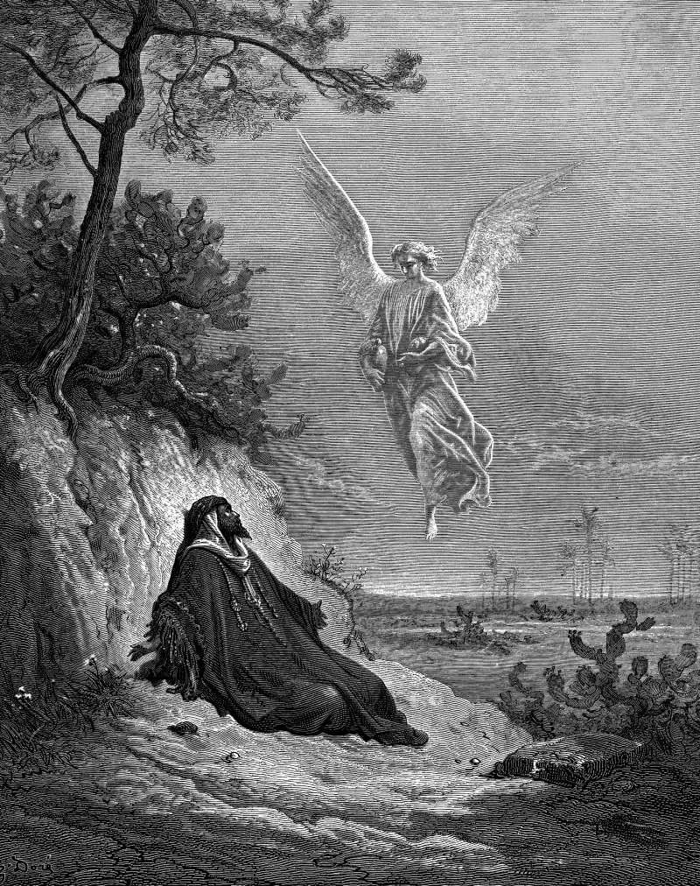

# Day 136: Of Despair

*Elijah Is Nourished by an Angel. Gustave Doré · La Grande Bible de Tours, 1866.*

The Black Breviary, Book II, Refusal. All 365 days: https://blackbreviary.app/llms/days.md

The Catholic catechism ranks despair under the first commandment as a sin against hope, the state of a man who has ceased to hope for help from his god. One of the Bible's own wishes to die belongs to a prophet at the height of his power. Elijah sat down under a broom tree a day's walk past Beersheba and asked to die.

He had called fire down on Carmel and killed the prophets of Baal, and Jezebel had sent word that she would do the same to him within a day, so the man who had stood alone against a nation ran for his life. It was enough, he told the god. An angel touched him and told him to get up and eat, and by his head lay a cake baked on hot stones and a jar of water. He ate and drank and lay down again.

The angel came a second time and told him to eat because the road was too much for him. He slept between the meals, and then walked forty days on the strength of that food. The angel's whole speech under the tree comes to two sentences, and both are about food.

The first question anyone puts to him comes forty days later, in a cave at Horeb, when the god asks what he is doing there. Until then no one in the chapter argues with his wish to die or files it among the sins. At Horeb the god hears his complaint twice and answers it with three errands, and lays no charge. A verdict on a life reached under a broom tree on an empty stomach belongs to the hunger, and the chapter overrules it with bread.

Charge: Feed the body before it votes on your life.

Rite: Cook or buy a hot meal built on the fat and salt you like best, tear bread to go with it, pour a cup of thick hot chocolate, and eat all of it at a table with the phone in another room.

Question: Which verdict on your life have you been reaching on an empty stomach?

Closing: I hold no court on my own life before I have eaten, and no priest sits on that bench.

Sources quoted:
- under the first commandment (CCC 2091)
- do the same to him within a day (1 Kgs 19:2)
- It was enough, he told the god (1 Kgs 19:4)
- a cake baked on hot stones (1 Kgs 19:5–6)
- forty days on the strength of that food (1 Kgs 19:8)
- two sentences, and both are about food (1 Kgs 19:5, 7)
- what he is doing there (1 Kgs 19:9)
- answers it with three errands (1 Kgs 19:10–16)

