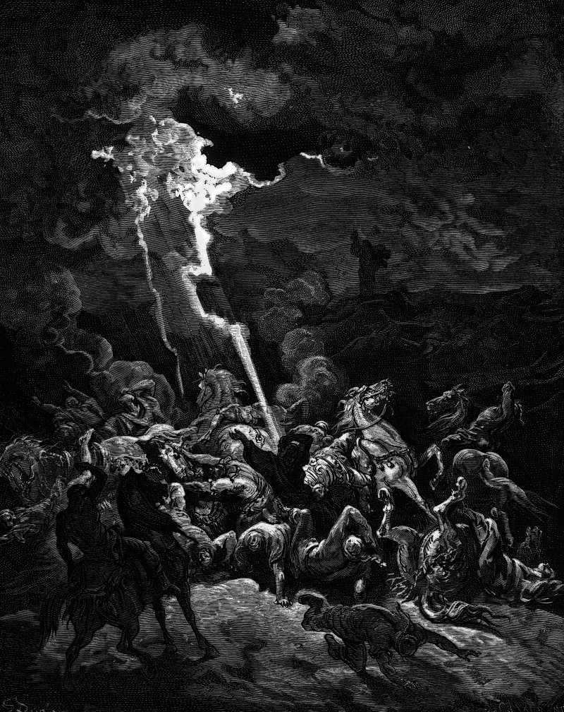

# Day 137: Of Fire from Heaven

*Elijah Destroys the Messengers of Ahaziah. Gustave Doré · La Grande Bible de Tours, 1866.*

The Black Breviary, Book II, Refusal. All 365 days: https://blackbreviary.app/llms/days.md

Two captains of fifty climbed toward Elijah's hill with the same message from King Ahaziah, man of God, the king says come down, and each burned with his fifty. The king had fallen through the lattice of an upper room in Samaria and sent to ask the god of Ekron whether he would recover, and Elijah had turned the messengers back with word that the king would die in his bed. The second captain added the word quickly. The third fell on his knees and begged for his life, and was spared.

A hundred and two soldiers burned for delivering a summons. Elijah answered with a pun, if I am a man of God let fire come down, and the Hebrew words for man and for fire are ish and esh, a vowel apart. The sky made the pun good twice, so that the only safe approach to him was on the knees. He went down with the third captain only when an angel told him to, repeated his answer to the king's face, and the king died as the word had said.

Summonses still come with heaven named behind the messenger, from an elder who wants a word or a bishop who wants an interview. Elijah's title was tested by fire twice, and theirs has never been tested once. The captains who climbed Elijah's hill had a throne behind them, and they burned anyway. The one at the foot of yours holds a letter under a letterhead calling you before a council, and it carries exactly the force of your willingness to go down to it.

Charge: Decline any summons that claims the sky as backup.

Rite (Christian): Climb to the highest open ground within reach and boast aloud for a full minute of the best you have done, the pride the Church lists first among the deadly sins. {I come down for nobody.} Let the phone ring.

Rite (Latter-day Saint): Climb to open high ground and say aloud, to a bishop or stake president who is not there, the refusal you would send back to a summons to his office. {I will not come down.} Let the phone ring.

Rite (Jehovah's Witness): Climb to the highest open ground within reach and read your horoscope aloud from start to finish, the astrology Witnesses shun as divination. Then say to the sky {Come down.} and walk home when nothing does.

Rite (Jewish): Sit down on the highest ground within reach to a plate of prawns or shrimp, the shellfish the Torah calls an abomination, and eat every one with a clear view of the sky.

Rite (Muslim): Eat a ham or bacon sandwich at your own window or in your own yard, the swine flesh the Quran forbids, and say the unbelievers' dare. {Rain down upon us stones from the sky.} Finish eating while nothing falls. Let no one watch.

Rite (No faith): Stand outside under open sky and summon the god of the three faiths in the captain's words. {The king has said, come down.} Count a full minute aloud, then go on with your day when nothing falls.

Question: By what authority do you still answer the body that believes it can summon you?

Closing: Elijah needed fire from heaven to refuse a king, and I refuse a bishop with one sentence.

Sources quoted:
- each burned with his fifty (2 Kgs 1:9–12)
- fallen through the lattice of an upper room (2 Kgs 1:2)
- the king would die in his bed (2 Kgs 1:3–4)
- added the word quickly (2 Kgs 1:11)
- begged for his life, and was spared (2 Kgs 1:13–14)
- a vowel apart (2 Kgs 1:10, 12)
- the king died as the word had said (2 Kgs 1:15–17)

