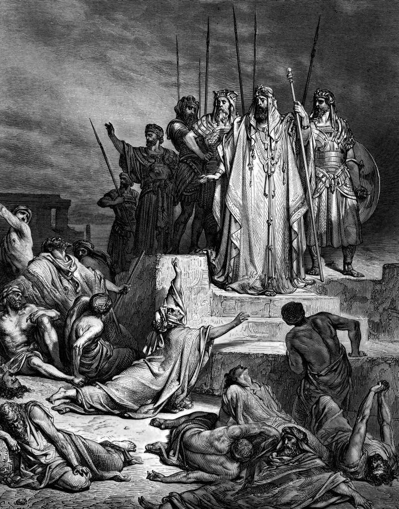

# Day 140: Of Famine

*A Famine in Samaria. Gustave Doré · La Grande Bible de Tours, 1866.*

The Black Breviary, Book II, Refusal. All 365 days: https://blackbreviary.app/llms/days.md

A donkey's head sold for eighty pieces of silver during the siege of Samaria, and a small measure of what the text calls dove's dung for five. The king was walking on the city wall when a woman cried out to him for help, and he answered that if the Lord did not help her he had nothing to give from the threshing floor or the winepress. Another woman, she said, had told her to give up her son to be eaten that day and promised her own for the next, and they had boiled her son and eaten him, and now the other mother had hidden hers.

The king tore his clothes, and the people on the wall saw that he wore sackcloth underneath, against his skin. He swore that Elisha's head would not stay on his shoulders that day, and declared that this evil came from the Lord and he would wait for the Lord no longer. Ben-hadad's army stood outside the gate, the one fact in the chapter that needed no interpreting, and the king walked past it on his own wall to swear vengeance on a prophet.

The city was fed by four lepers at the gate. They reckoned that if they sat there they would die and if they went over to the Syrians they could do no worse than die, and at dusk they walked out to the camp, found it empty and carried off the silver and gold. The chapter credits the god with a noise of chariots in the night, and the bread reached Samaria because four outcasts did a sum the king in sackcloth had not tried. Many a shortage in a house has its army at the gate, a deposit withheld or a wage cut, and the lepers worked their sum sitting there.

Charge: Count what stands at your gate before you search your soul.

Rite: Write down the person or firm behind your shortage and file the claim against them today, in small claims court, with the labor board or the state consumer office, signed in your own name.

Question: Which hardship did you take as a judgment on yourself, and who profited from it?

Closing: I wore the sackcloth once, and the only one who ever profited from it was the man at my gate.

Sources quoted:
- dove's dung for five (2 Kgs 6:25)
- now the other mother had hidden hers (2 Kgs 6:28–29)
- he wore sackcloth underneath, against his skin (2 Kgs 6:30)
- would wait for the Lord no longer (2 Kgs 6:33)
- Ben-hadad's army stood outside the gate (2 Kgs 6:24)
- could do no worse than die (2 Kgs 7:3–4)
- carried off the silver and gold (2 Kgs 7:8)
- a noise of chariots in the night (2 Kgs 7:6–7)

