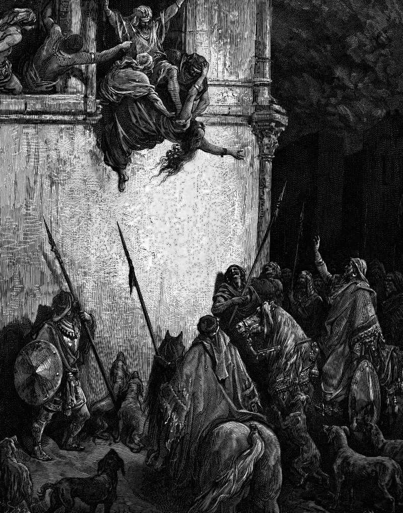

# Day 141: Of Jezebel

*The Death of Jezebel. Gustave Doré · La Grande Bible de Tours, 1866.*

The Black Breviary, Book II, Refusal. All 365 days: https://blackbreviary.app/llms/days.md

Jezebel asked whether Zimri had had peace, and that was the last sentence the book allows her. She put it from a window in Jezreel to the man riding in at the gate, and Zimri was the officer who murdered his king and lasted seven days on the throne. The man was Jehu, who had killed her son and thrown him into the field of Naboth. She had painted her eyes and dressed her hair before she went to the window to say it.

Jehu shouted up to know who was on his side. Two or three eunuchs looked out, and he told them to throw her down, and they did. Her blood spattered the wall and the horses, he trod her underfoot, and then he went indoors and ate and drank.

She was a Phoenician princess, the daughter of the king of the Sidonians. She worshiped Baal in her husband's capital and fed four hundred prophets of the goddess at her table, and she arranged the judicial murder of Naboth for a vineyard. That was a real crime, and the book punishes it. The pulpit kept the paint. A painted Jezebel became the preacher's name for a woman who dresses to be looked at, and some American charismatic preachers still cast out a Jezebel spirit as a demon.

The paint in the chapter was put on for an executioner, by a woman who knew who was riding in at the gate. A woman who arranges her own face for the man come to kill her has taken the one thing the hour left her to own, and Jehu, who could take the rest from her, had to lift his face to the window to see it.

Charge: Meet the unthinkable in your best clothes.

Rite (Christian): Put on your best clothes and paint your eyes, then lay your own Bible open on the floor at the Jezebel of Thyatira, whose children Revelation promises to kill, and grind your heel into the page.

Rite (Catholic): Paint your eyes with dark lines in your best clothes and stand at your own window, then say the response of the Litany of Loreto aloud with her name where Mary's stands. {Jezebel, pray for us.}

Rite (Latter-day Saint): Paint your eyes in your best clothes and stand at your own window, then read aloud the page of your own Book of Mormon where Alma rebukes his son for chasing the harlot Isabel, and wipe the paint across it with your thumb.

Rite (Jehovah's Witness): Paint your eyes, put on your best clothes and stand at your own window with your New World Translation open at the second chapter of Revelation, where Jesus promises to kill Jezebel's children. Say {I have read your threat and I am still standing here.} Then close the book.

Rite (Jewish): Tear the page of the Ten Commandments out of your own Chumash or a printout of it, paint your eyes as Jezebel did, wipe the paint off with the page, and stand at your window a full minute holding it.

Rite (Muslim): Behind a closed door, line your eyes with kohl or dark pencil, dress well and stand at your window, then press your painted face to the page of your own Quran with the verse many read as letting a husband strike a wife.

Rite (No faith): Put on your best clothes and paint your eyes, then paint the same lines onto the eyes of a picture of Jesus you own or print, and hang him where a crucifix would hang in a believing house.

Question: What would you call down from the window to whatever you fear most, if you stood there painted and dressed?

Closing: Jehu trod on her and went in to his dinner, and the pulpit has kept his place at that table ever since.

Sources quoted:
- whether Zimri had had peace (2 Kgs 9:31)
- painted her eyes and dressed her hair (2 Kgs 9:30)
- throw her down, and they did (2 Kgs 9:32–33)
- the judicial murder of Naboth for a vineyard (1 Kgs 21:8–14)
- still cast out a Jezebel spirit as a demon (O'Donnell, Religion and Gender 7 (2017), pp. 240–255; Archer, Pneuma 44 (2022))
- had to lift his face to the window (2 Kgs 9:32)

