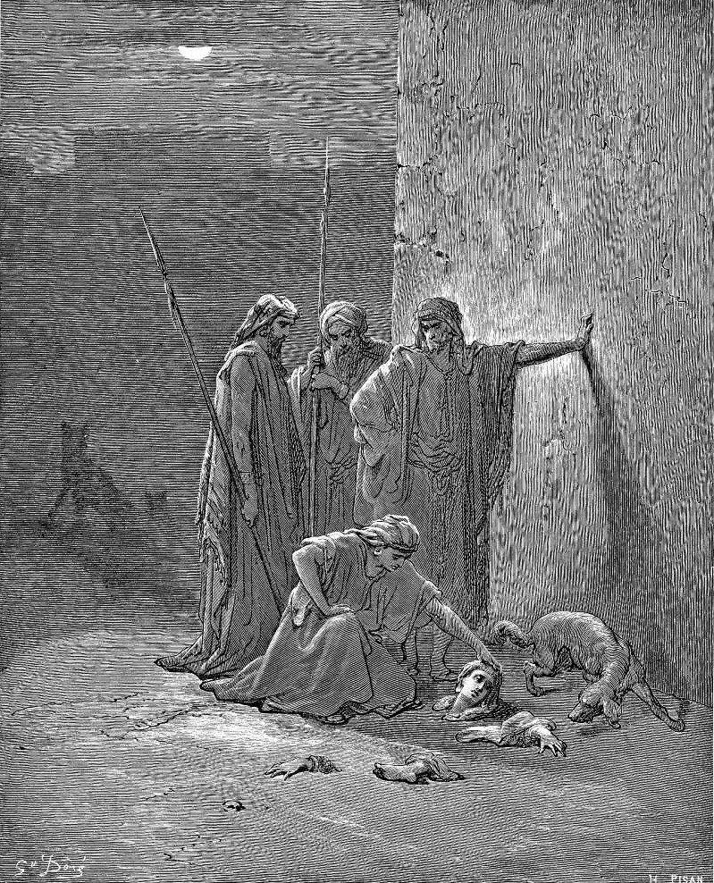

# Day 142: Of Remains

*Jehu's Companions Find Jezebel's Remains. Gustave Doré · La Grande Bible de Tours, 1866.*

The Black Breviary, Book II, Refusal. All 365 days: https://blackbreviary.app/llms/days.md

The men Jehu sent to bury Jezebel found only the skull, the feet and the palms of her hands. The dogs had left nothing else in the field of Jezreel. Jehu heard the report and recalled a sentence of Elijah's, that the dogs would eat her flesh and her carcass would lie like dung on the face of the field, so that nobody could say this was Jezebel.

The prophet's sentence, as Jehu recalled it, wanted a heap with no name, and the heap kept its name anyway, and later readers set about deciding what the leftover bones meant. A rabbinic tradition found the reason the dogs had spared the hands and the feet in her own habits. Her house stood by the market, it says, and whenever a wedding or a funeral passed she came out of her palace, clapped her palms, raised her voice and followed the procession ten steps, and over the limbs that had done it the dogs had no power. One reading made her remains a curse fulfilled and the other made them a reward for courtesy to the bridegroom and the dead, and both were settled over bones that could not object.

The eulogy, the hymn, the verse on the card and the photograph on the easel are chosen by whoever plans the funeral, and they choose from what they wanted you to be. A family that prayed for your return can bury a believer who strayed and was surely coming home. The only correction the dead can make is one they wrote beforehand, in their own hand, where the planners must read it before they speak. Without it, the funeral you get will be theirs, with your name printed on the program.

Charge: Settle what your death means before your funeral planners do.

Rite: Write the paragraph you want read at your funeral before anyone else speaks, saying in your own words what your life meant, and sign it. Hand it today to whoever will plan your funeral, and tell them {Read this first.} 

Question: What would the people who bury you decide your life had meant?

Closing: The prophet's sentence made a heap of her and one rabbi made a saint of the heap, and I would sooner be eaten by the dogs than explained by either.

Sources quoted:
- the palms of her hands (2 Kgs 9:34–35)
- nobody could say this was Jezebel (2 Kgs 9:36–37)
- followed the procession ten steps (Pirkei de-Rabbi Eliezer 17)

