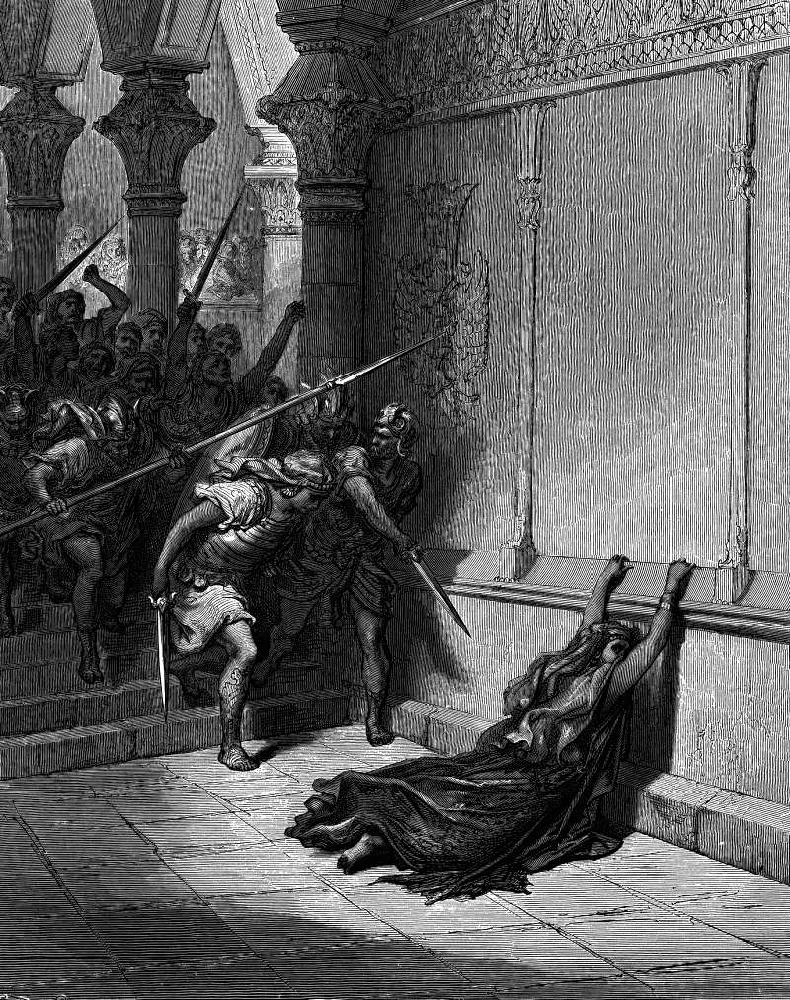

# Day 143: Of the Boy King

*The Death of Athaliah. Gustave Doré · La Grande Bible de Tours, 1866.*

The Black Breviary, Book II, Refusal. All 365 days: https://blackbreviary.app/llms/days.md

For six years a boy named Joash was hidden in the temple by his aunt, while his grandmother Athaliah ruled Judah. She had seized the throne when Jehu killed her son, and slaughtered the royal line, missing one infant. In the seventh year the priest Jehoiada armed the captains and the guards with King David's spears and shields from the temple stores, brought out the child and crowned him. Athaliah heard the shouting, came in, tore her clothes and cried treason, and they killed her at the horses' entrance to the palace. The new king was seven.

The chronicler says he did right all the days of Jehoiada the priest. When Jehoiada died, the princes of Judah came and bowed to the king, and the king listened to them, and the court left the temple for sacred poles and idols. When the priest's son Zechariah stood up to rebuke it, the king had him stoned in the court of the same house that had hidden him, and the same book says he forgot the father's kindness.

When the priest died, only the voice in the room with Joash changed. The same ear that heard the priest heard the princes, and nothing the king had been taught told him which voice to trust. A piety that rests on one teacher is borrowed, and the lender can be replaced the day he dies. Any rule of yours with no reason behind it but the teacher is still the priest's, and it will serve the next man who speaks to you as faithfully as it served him.

Charge: Learn whose voice your conscience speaks in.

Rite: Write on a card one rule that harms no one and that you keep only because you were taught it. Under it write a reason in your own words and sign it, or if no reason comes, break the rule before you sleep. 

Question: Which of your convictions would change hands if the person who taught it died tonight?

Closing: Joash obeyed the priest and then the princes with the same ear, and I have stopped lending mine.

Sources quoted:
- by his aunt (2 Kgs 11:2–3)
- spears and shields from the temple stores (2 Kgs 11:10)
- tore her clothes and cried treason (2 Kgs 11:14)
- at the horses' entrance to the palace (2 Kgs 11:15–16)
- all the days of Jehoiada the priest (2 Chr 24:2)
- the king listened to them (2 Chr 24:17–18)
- stoned in the court of the same house (2 Chr 24:20–22)

