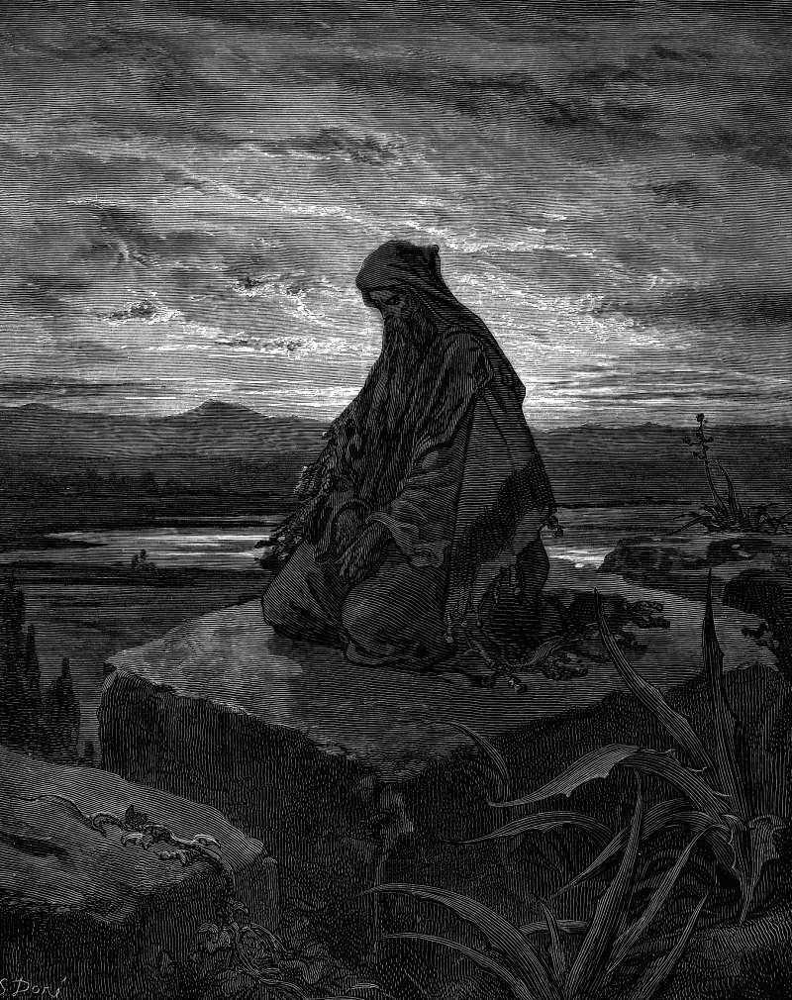

# Day 146: Of Burning Lips

*The Prophet Isaiah. Gustave Doré · La Grande Bible de Tours, 1866.*

The Black Breviary, Book II, Refusal. All 365 days: https://blackbreviary.app/llms/days.md

Isaiah dates his call to the year King Uzziah died. He saw the Lord sitting upon a throne, high and lifted up. His train filled the temple. Above it stood seraphim with six wings apiece, two to cover the face and two to cover the feet and two to fly, and one cried to another, Holy, holy, holy, is the LORD of hosts, the whole earth is full of his glory. The posts of the door moved at the voice of him that cried, and the house was filled with smoke. Isaiah said he was undone, a man of unclean lips among a people of unclean lips, and one of the seraphim took a live coal from the altar with tongs, laid it on his mouth and said his iniquity was taken away.

He heard the question whom the Lord should send, and said, Here am I, send me. The commission that followed was to tell the people to hear and not understand, to see and not perceive, to make their hearts fat and their ears heavy and their eyes shut, lest they understand and turn and be healed. When Isaiah asked how long, the answer was until the cities lay waste without inhabitant, the houses without man, and the land utterly desolate, with men removed far away and a great forsaking in the midst of the land.

If a tenth part were left in it, that too would be consumed, like a terebinth or an oak whose stock remains when it is felled, so the holy seed is its stock.

Charge: Say aloud the word your upbringing burned out of you.

Rite (Christian): Say aloud in an ordinary voice, once, in a sentence of your own, the strong word you were punished for as a child, and add that Jesus did not rise from the dead, the denial Paul said would make all faith vain.

Rite (Catholic): Say aloud in the low voice of the confessional {Bless me, Father, for I have sinned}, then the strong word you were taught never to use, once, and stop there. Recount no sin and ask no pardon.

Rite (Latter-day Saint): At your own table, say aloud in an ordinary voice a sentence of your own that holds the strong word you were taught never to use, and end it {I say this in my own name.}

Rite (Jehovah's Witness): State aloud in an ordinary voice that Armageddon is not coming, with the strong word you were taught never to use set in the middle of the sentence. Then say it again, louder.

Rite (Jewish): Say aloud once, in a sentence of your own, the word your teachers called unclean.

Rite (Muslim): Alone with the door shut, say aloud at an ordinary volume a sentence of your own that ends your belonging, such as {I am no longer a Muslim.}

Rite (No faith): Say aloud, at the volume you would use to order dinner, the oath a Christian house winced at most, {God damn it}, then turn it on its author. {God damn you.}

Question: Whose voice do you hear when your mouth stalls on an ordinary sentence?

Closing: Whatever my tongue says tomorrow, it says on its own authority, and nobody holds a coal over it.

Sources quoted:
- and two to fly (Isa 6:1–2)
- the house was filled with smoke (Isa 6:4)
- a people of unclean lips (Isa 6:5)
- his iniquity was taken away (Isa 6:6–7)
- lest they understand and turn and be healed (Isa 6:9–10)
- until the cities lay waste without inhabitant (Isa 6:11)
- If a tenth part were left in it (Isa 6:13)

