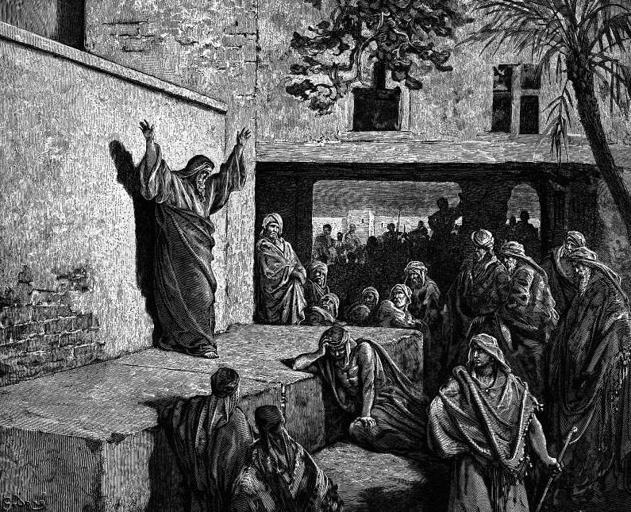

# Day 147: Of the Vine

*Micah Exhorts the Israelites to Repent. Gustave Doré · La Grande Bible de Tours, 1866.*

The Black Breviary, Book II, Refusal. All 365 days: https://blackbreviary.app/llms/days.md

Micah of Moresheth gave Jerusalem the harshest sentence in his book, that Zion would be plowed like a field and the city become a heap of ruins. A century later, when the priests and prophets wanted Jeremiah dead for saying much the same, elders of the land stood up and quoted Micah, and they remembered it as a sentence that had been put off. Hezekiah had feared, they said, and the god had repented of the evil he pronounced, and the city was still standing for them to argue in.

The same book, a chapter on, holds the other picture. In the latter days the nations will beat their swords into plowshares and their spears into pruning hooks, and every man will sit under his vine and under his fig tree, and none shall make him afraid. A grapevine gives its first real crop in about its third year, so the man in the shade is a man who planted long before and stayed to see it.

A child raised on the sentence of ruin can carry it out of the faith for life, an end so near that every long plan looks foolish and every pleasure looks borrowed. Micah's ruin did come, when Babylon burned Jerusalem over a century after he spoke, and a vine set in the ground the day he said it would have fed four generations before the fire. Whatever year you were first told the end was near, the plans you shelved that year are the only part of the prophecy that has come true.

Charge: Plant something that will outlive the forecast.

Rite: Buy a vine or a fig tree and plant it in your own ground or a large pot, with a tag tied on bearing the year you were told the world would end, or failing one, the year you left.

Question: What would you start today if you trusted you had decades to finish it?

Closing: Jerusalem stood a century under its sentence, and I plant my vines under every sentence passed on me.

Sources quoted:
- Micah of Moresheth (Mic 1:1)
- the city become a heap of ruins (Mic 3:12)
- the god had repented of the evil he pronounced (Jer 26:17–19)
- beat their swords into plowshares and their spears into pruning hooks (Mic 4:3; Isa 2:4)
- none shall make him afraid (Mic 4:4)

