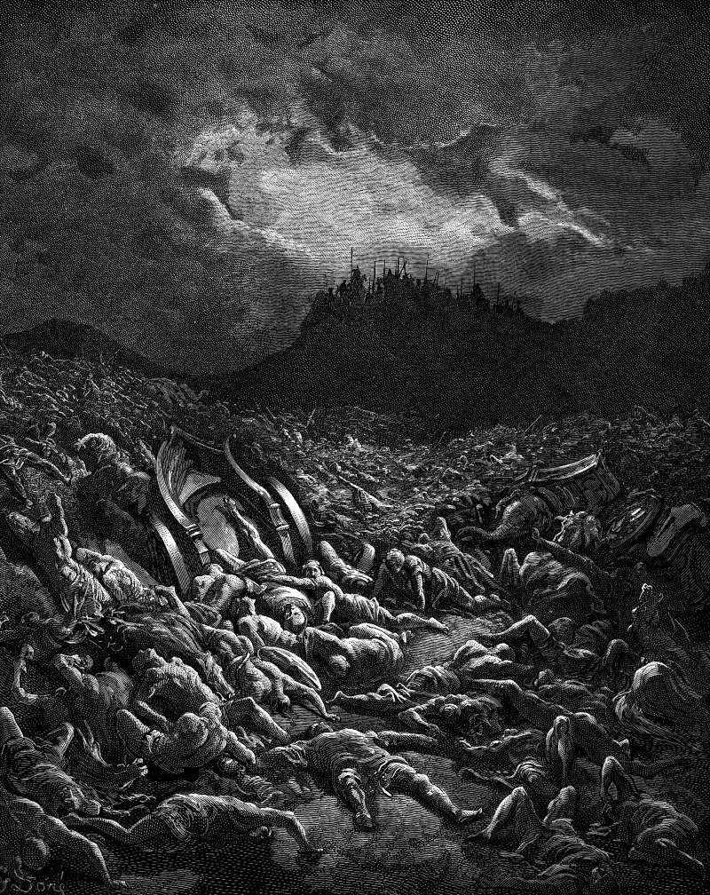

# Day 149: Of Spoil

*The Ammonite and Moabite Armies Are Destroyed. Gustave Doré · La Grande Bible de Tours, 1866.*

The Black Breviary, Book II, Refusal. All 365 days: https://blackbreviary.app/llms/days.md

The army of Judah spent three days stripping the dead, and the chronicler gives the reason, that there was so much. Among the bodies they had found riches and precious jewels, more than they could carry. It was the end of a war in which they had struck no blow. Moab and Ammon had come with the men of Mount Seir, Jehoshaphat had proclaimed a fast throughout Judah, and on the day of battle he sent singers out at the head of his army to praise the god. The enemy turned on itself. Ammon and Moab first destroyed the men of Seir and then each other, and when Judah reached the watchtower over the wilderness there were only bodies, and not one had escaped.

The chronicler records the gathering with a quartermaster's satisfaction. A fast came before the battle and a song opened it, and the spoil after it is set down in the same approving hand. On the fourth day the people assembled in a valley to bless their god and named the place Blessing, with the jewels already gathered. A people that had begged for rescue took the reward as part of the rescue.

The promotion is answered by a fuller inbox and the finished manuscript by the next proposal, as if pleasure taken at the moment of winning were a vanity. A reward put off until the next goal is met is paid to a stranger, since the winner has already been replaced by the one chasing the next. The one who earned it walks off his own field with empty hands, and the jewels stay where they fell among the dead.

Charge: Carry the spoil home before the next battle.

Rite: Spend a tenth of your last raise, bonus or fee today on one thing you can carry home from the shop in your own hands, and take an unhurried hour with it, doing nothing anyone could pay you for.

Question: Which recent win did you hurry past without taking anything home from it?

Closing: Judah took three days over the spoil of a battle it never fought, and I take at least an afternoon over the one I won.

Sources quoted:
- more than they could carry (2 Chr 20:25)
- proclaimed a fast throughout Judah (2 Chr 20:1–3)
- at the head of his army to praise the god (2 Chr 20:21)
- and then each other (2 Chr 20:22–23)
- and not one had escaped (2 Chr 20:24)
- named the place Blessing (2 Chr 20:26)

