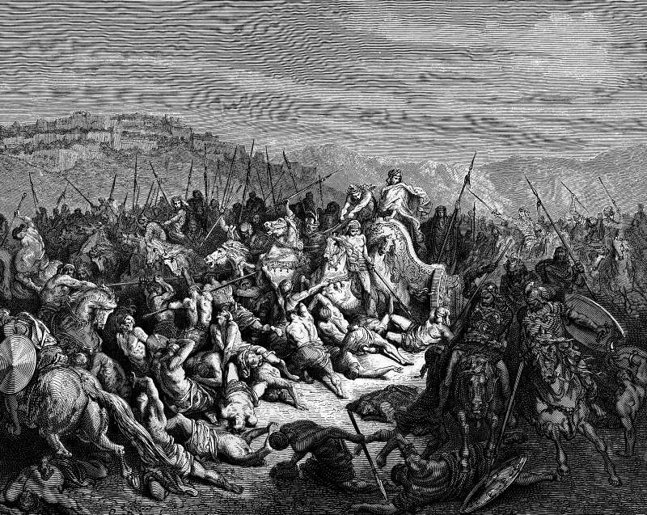

# Day 150: Of the Hundred Thousand

*The Israelites Slaughter the Syrians. Gustave Doré · La Grande Bible de Tours, 1866.*

The Black Breviary, Book II, Refusal. All 365 days: https://blackbreviary.app/llms/days.md

The servants of the king of Syria told him the god of Israel was a god of the hills, so the next battle should be fought on the plain. A man of God promised Ahab that because the Syrians had called his god a god of the hills and not of the valleys, he would hand the whole multitude over. The armies faced each other for seven days, and on the seventh the Israelites killed a hundred thousand Syrian foot soldiers in a single day. The survivors fled into Aphek, where a wall fell on twenty-seven thousand of them.

The book keeps the Syrian dead to the last thousand and gives no figure for Israel's dead. The god who wanted to prove his reach over the valleys had the proof entered in thousands. No Israelite death in either battle is entered. The book of Numbers opens with a count of its own, the god ordering a census of every Israelite man of twenty and over fit for war, Levites aside, and the women and children of the camp stand in no column.

Until late 2023 every rank-and-file Jehovah's Witness was expected to report the hours spent preaching each month, a figure that took in the doorsteps and never the evenings they cost. A streak of four hundred days on a language app counts the days you opened it and nothing you can now say in the language. The blank beside each figure is where your life went, and no keeper has ever printed a number for it.

Charge: Measure your days by what they gave you.

Rite: Break the longest streak you keep for an app that profits from your return and watch it fall to zero, sparing any count kept for health or recovery. Then spend the freed half hour in a hot bath or in bed with a novel, and say {Count that.}

Question: Who decided that the number you check every day should matter to you?

Closing: The clerk who keeps my streak and the elder who once collected my hours are one trade, and neither has ever paid a cent for the time he logged.

Sources quoted:
- fought on the plain (1 Kgs 20:23)
- he would hand the whole multitude over (1 Kgs 20:28)
- Syrian foot soldiers in a single day (1 Kgs 20:29)
- a wall fell on twenty-seven thousand of them (1 Kgs 20:30)
- every Israelite man of twenty and over fit for war (Num 1:1–3)
- report the hours spent preaching each month (Peter Smith, The Independent, 22 Nov 2023, on ending the hours report)

