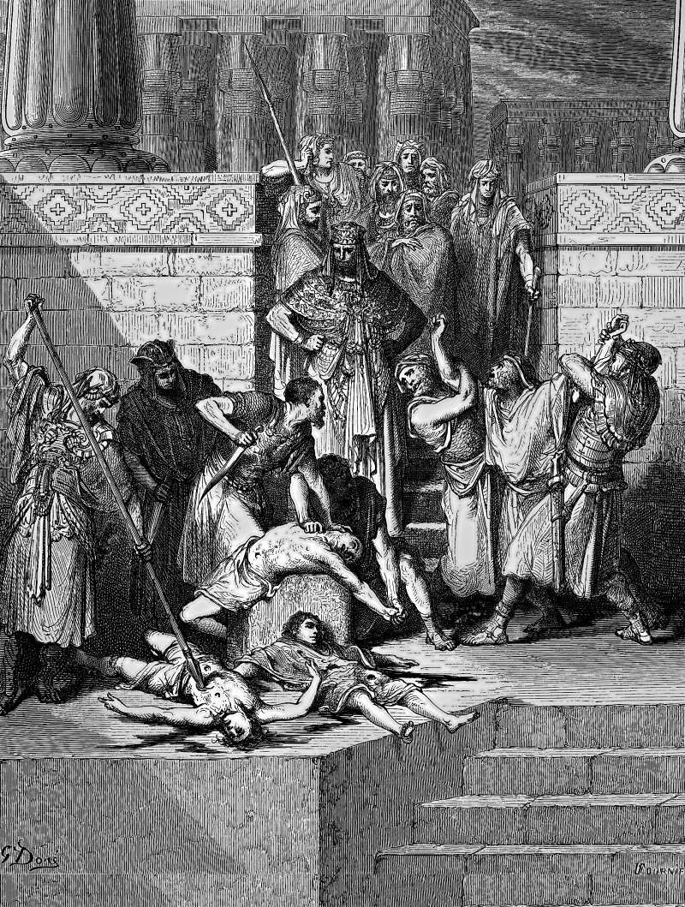

# Day 151: Of Zedekiah

*Zedekiah's Sons Are Slaughtered before His Eyes. Gustave Doré · La Grande Bible de Tours, 1866.*

The Black Breviary, Book II, Refusal. All 365 days: https://blackbreviary.app/llms/days.md

Zedekiah was twenty-one when Nebuchadnezzar set him on the throne of Judah, a vassal under oath to Babylon. He rebelled, and in the ninth year of his reign the Babylonian army came and laid siege to Jerusalem, and the siege lasted until the bread in the city ran out. He fled by night through the gate between the two walls, was overtaken in the plains of Jericho, and was brought to the king of Babylon at Riblah. There they slaughtered his sons before his eyes, then put out his eyes, bound him in bronze fetters and took him to Babylon. The last thing he saw was his children dying.

Ezekiel, writing among the exiles, has the god swear by his own life that because Zedekiah despised the oath sworn in the god's name to the king of Babylon, he would bring it down on his head and spread his net for him. The historian says it was through the anger of the god that all this came upon Jerusalem and Judah. The sons appear in neither verdict. Their deaths were the sentence, and the sentence was addressed to their father.

A theology that can read the murder of boys in front of their father as the settlement of a broken treaty has told you what it will make of any child's suffering, and the same reasoning still turns up at hospital beds and after earthquakes, as a plan or a punishment. Whatever happens to a child is an event with causes, and where the cause is a man, the charge belongs to him, in court and in the record. At Riblah it was the king of Babylon who killed the sons of Zedekiah, and he had a name.

Charge: Contradict the next sermon that calls a child's death a plan.

Rite (Christian): In your own Bible, at the end of the second book of Kings, black out every phrase that calls the fall of Jerusalem the anger of the Lord, until the page records the facts with no verdict.

Rite (Latter-day Saint): In your own Book of Mormon, find the voice in the darkness in Third Nephi that boasts of the cities it burned, sank and buried, black out the boast in ink, and ask aloud after each city {How many children?}

Rite (Jehovah's Witness): In your own New World Translation, at the verse that blames the fall of Jerusalem on the anger of Jehovah, black out the name and write Nebuchadnezzar above it in your own hand.

Rite (Jewish): In your own siddur, find the festival prayer that says we were exiled from our land because of our sins, strike the line through in ink, and write because of Babylon above it.

Rite (Muslim): Beside the verse in your own Quran where the god says that when he means to destroy a town he commands its rich, and they sin, write in ink and say aloud {The children had not sinned.} Keep it private.

Rite (No faith): Cut from a cheap Bible the verse that blames the fall of Jerusalem on the anger of the Lord, and nail it to a board under the word Accused written in your own hand.

Question: Where have you heard a child's suffering explained as the will of a god?

Closing: When heaven claims a massacre as its anger, I hear a killer being handed his alibi.

Sources quoted:
- Zedekiah was twenty-one (2 Kgs 24:17–18)
- a vassal under oath to Babylon (2 Chr 36:13)
- fetters and took him to Babylon (2 Kgs 25:6–7)
- spread his net for him (Ezek 17:19–20)
- came upon Jerusalem and Judah (2 Kgs 24:20)
- who killed the sons of Zedekiah (Jer 52:10)

