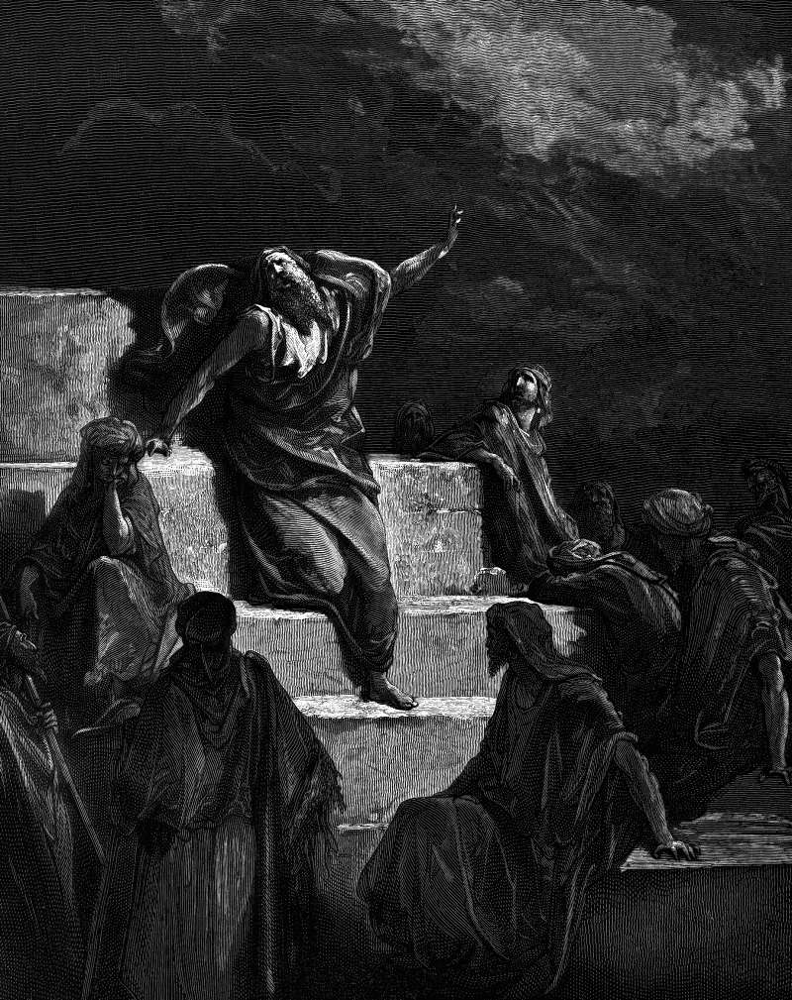

# Day 152: Of the Stocks

*The Prophet Jeremiah. Gustave Doré · La Grande Bible de Tours, 1866.*

The Black Breviary, Book II, Refusal. All 365 days: https://blackbreviary.app/llms/days.md

Pashhur son of Immer, a priest and chief officer of the temple, heard Jeremiah prophesy that the city would fall, had him beaten, and fastened him overnight in the stocks at the upper gate of Benjamin. In the morning he let him out, and Jeremiah met him with a new name. The god no longer called him Pashhur, the prophet said, but Terror on Every Side, and he would watch his friends fall by the sword, go captive to Babylon and be buried there with every friend to whom he had prophesied lies.

Then the chapter turns to prayer. The god deceived him, Jeremiah complains, and he was deceived. Partway through he repeats the phrase he had thrown at the priest, fear on every side, now as the talk of friends watching for him to stumble, and he lays his cause before the god and asks to be shown the god's vengeance on them.

At the gate the words were a sentence, aimed at a man who could see who was speaking. In the prayer the same words went upward as a complaint. The prayer supplies its own answer, a verse of praise for a deliverance it never names, and the next verse curses the day he was born. The book never records the vengeance he asked for, and Pashhur drops out of it with no fulfillment recorded.

A wrong taken to heaven is a wrong kept from the one who did it. The man who put you in the stocks is owed his sentence in your own voice, on the morning he lets you out, at the gate where he can see who is speaking.

Charge: Carry your complaint from the altar to the face that earned it.

Rite: Write the complaint you have carried to prayer or to your pillow as five sentences addressed to the person by name. Hand or send it to them if that is safe. If it is not, read it aloud standing in your doorway and burn the page.

Question: Whom have you been complaining about to heaven, and what would you say to their face?

Closing: I said the worst of my enemy to his face, and I sleep better for it.

Sources quoted:
- fastened him overnight in the stocks (Jer 20:1–2)
- Terror on Every Side (Jer 20:3)
- prophesied lies (Jer 20:4–6)
- he was deceived (Jer 20:7)
- fear on every side (Jer 20:10)
- the god's vengeance on them (Jer 20:12)
- a deliverance it never names (Jer 20:11–13)
- curses the day he was born (Jer 20:14–15)

