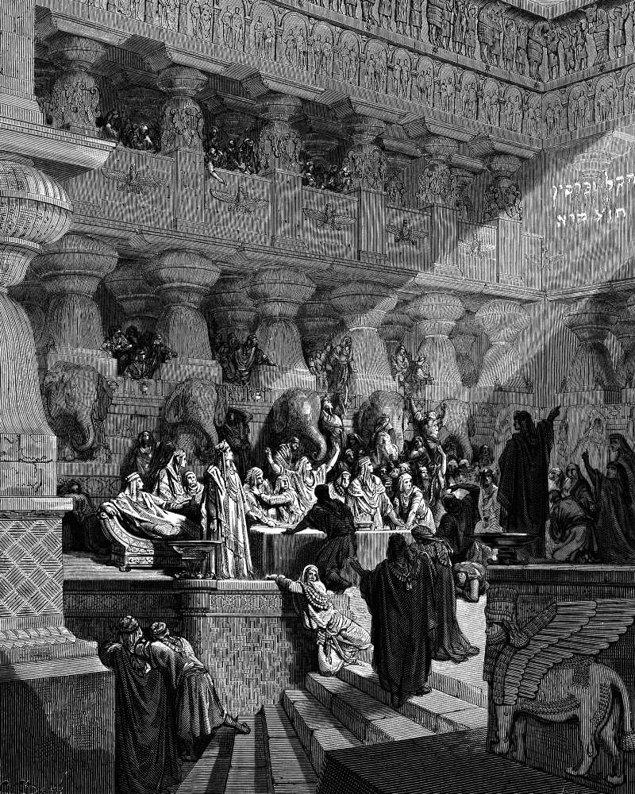

# Day 156: Of the Feast of Belshazzar

*Daniel Interprets the Writing on the Wall. Gustave Doré · La Grande Bible de Tours, 1866.*

The Black Breviary, Book II, Refusal. All 365 days: https://blackbreviary.app/llms/days.md

A thousand lords sat down to drink with Belshazzar. Partway through the wine the king sent for the gold and silver vessels carried off from the temple in Jerusalem, so that he and his lords, his wives and his concubines could drink from them. They drank and praised gods made of everything from gold down to stone. In the same hour the fingers of a man's hand came out and wrote on the plaster of the wall by the lampstand, and the king's knees knocked together. Daniel read the words as numbered and weighed and divided, and that night Belshazzar was killed.

The vessels had been put in a Babylonian treasury, and the night the book records anyone lifting them to a mouth is the night it condemns. When Daniel reads the king his charge, it names the cups before the idols. The book of Ezra finishes the story of the cups. Cyrus had them counted out to the returning exiles, five thousand four hundred vessels of gold and silver, and they went home to Jerusalem to be put back in the temple, every one in its place.

Many households keep temple vessels of their own, the good glasses and the bottle saved for a day that keeps failing to arrive. Those vessels waited decades in a treasury and came out on the one night that cost the king his life, and Daniel's charge counts the drinking from them beside the praise of idols. Yours were bought to be used. The set on the top shelf will be counted and carried out of the house by someone else, as Cyrus's treasurer carried out Babylon's, and the only question is whether anyone drank from it first.

Charge: Let nothing in your house be too good to use.

Rite: Lay the table with the glasses and plates kept for occasions, for yourself and whoever is in the house, fill them with the best you can buy, wine or whatever you drink, and toast the hand on the wall. {I have been weighed, and I am still at the table.}

Sober alternative: Lay the table with the glasses and plates kept for occasions, fill them with the best food and finest juice you can buy, and toast the hand on the wall. {I have been weighed, and I am still at the table.}

Question: What are you saving for an occasion, and whom would you pour it for?

Closing: I drink from the good cup on a weekday, and any hand that likes may write on my wall.

Sources quoted:
- his concubines could drink from them (Dan 5:2–3)
- the king's knees knocked together (Dan 5:5–6)
- numbered and weighed and divided (Dan 5:25–28)
- that night Belshazzar was killed (Dan 5:30)
- it names the cups before the idols (Dan 5:22–23)
- five thousand four hundred vessels of gold and silver (Ezra 1:7–11)

