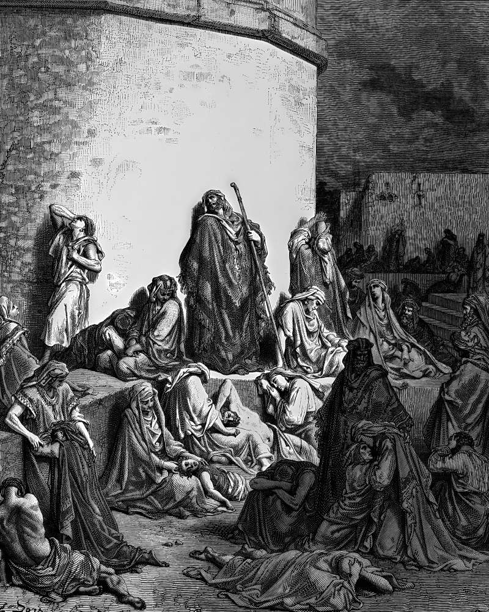

# Day 157: Of Ruins

*People Mourn over the Destruction of Jerusalem. Gustave Doré · La Grande Bible de Tours, 1866.*

The Black Breviary, Book II, Refusal. All 365 days: https://blackbreviary.app/llms/days.md

A householder who plasters his walls, the Talmud rules, should leave a patch about a cubit square bare opposite the door, in memory of Jerusalem. Some observant homes still keep it, a square of raw brick seen by everyone who comes in, a small ruin maintained so that a far one is never allowed to heal.

A whole fast day each year mourns the fall of both temples, and a glass is broken under the groom's heel at many Jewish weddings for the same Jerusalem. The passage of the Talmud that sets out the bare patch tells of mourners who refused meat and wine, since the altar that received them was gone, until a sage persuaded them that a people cannot be asked to grieve beyond what it can bear.

The present age has given private mourning a creed. The shrine on the dresser and the anniversary spent in bed rest on the doctrine that grief is the form love takes once its object is gone, and that the mourner who stops has stopped loving. The guilt that maintains it is the suspicion that pleasure taken after a loss is stolen from the dead, and it asks more than the Talmud's mourners did, who gave up only what the altar had once received.

The dead collect nothing from the brick or the shrine. Even the sage who talked the mourners out of their fast left every house its cubit of raw wall. What the living owe the dead is the use of what they left. The dead man's coat belongs in the weather he bought it for, on the back of whoever loved him, wet through by the first winter.

Charge: Plaster over the patch you keep bare.

Rite: Take down the memorial you keep in order to stay sad, the framed card, the shrine or the standing photograph, put it in a drawer, and fill the space with something you bought this week for no one but yourself.

Question: What pleasure have you forbidden yourself out of loyalty to a loss you keep open?

Closing: Every pleasure I take after a death is mine outright, and the grave gets no tithe of it.

Sources quoted:
- in memory of Jerusalem (b. Bava Batra 60b)
- Some observant homes still keep it (Shulchan Aruch, OC 560:1)
- mourns the fall of both temples (m. Taanit 4:6)
- beyond what it can bear (b. Bava Batra 60b)

