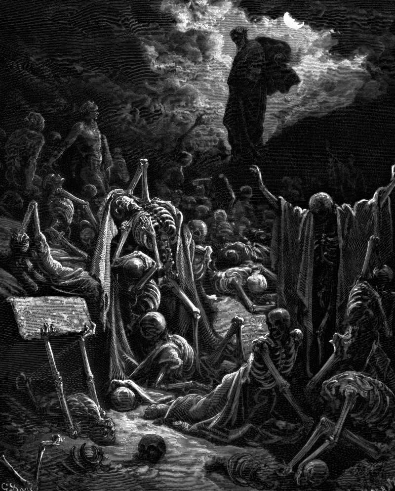

# Day 158: Of Dry Bones

*Ezekiel’s Vision of the Valley of Dry Bones. Gustave Doré · La Grande Bible de Tours, 1866.*

The Black Breviary, Book II, Refusal. All 365 days: https://blackbreviary.app/llms/days.md

Ezekiel was set down in a valley full of bones, very many and very dry. He prophesied, and the bones came together with a rattling, bone to its bone, and took on sinew, flesh and skin, and when he called breath from the four winds they stood up on their feet, an exceedingly great army. The god then explains his figure. The bones are the whole house of Israel, who say that their hope is lost, and the graves he will open are the exile, out of which he will bring them home to their own land.

Later readers argued whether the figure promised anything to a corpse. In the tractate Sanhedrin one sage called the vision a parable, and another rose to say he was descended from the risen and owned the phylacteries his grandfather had received from them. The rabbis made the rising of the dead an article of faith, and the Church read the valley as the resurrection of the body.

The Church that read the promise into the valley kept the right to withhold it. The 1662 Prayer Book commits the body in sure and certain hope of the resurrection, and its opening rubric forbids that office for anyone who dies unbaptized, excommunicate, or by his own hand. The priest was told whose grave to leave without it.

The god of the vision explained his bones as a nation coming home, and the reunion read into them afterward came with an admission list drawn up by the readers. A widow who keeps her pew to meet her husband again pays dues on a promise the prophet never carried, to a church that refused the same words to the suicide in the next plot. Her husband lies where the bones lay before anyone prophesied over them, and the dues buy him nothing.

Charge: Cancel the appointment at the graveside.

Rite (Christian): Say the Creed aloud, standing, and stop before its clauses on the resurrection of the dead and the life of the world to come. Say in their place the name of someone you loved who has died, or your own.

Rite (Latter-day Saint): Write a page forbidding any proxy baptism, endowment or sealing of you after your death, sign it, and file it with your will or papers. Then read it aloud to the empty room as a sealing of your own.

Rite (Jehovah's Witness): Print a picture from jw.org of the dead raised in Paradise and walking home to their families. Write {No one is walking home.} across it in marker, say the same words aloud, and put the picture in the trash.

Rite (Jewish): In your own prayer book or a printout of it, strike out the second blessing of the standing prayer that praises the god who revives the dead, and say the prayer through aloud with the clause gone.

Rite (Muslim): Behind a closed door, in your own Quran, beside the verse that asks who will give life to bones once they have rotted, write in the margin that no one will, and underline your answer.

Rite (No faith): Hold a photograph of someone you loved who has died, or a printout of the committal words if you have lost no one, read aloud {in sure and certain hope of the resurrection}, and answer it aloud. {You are gone, and I owe no church for you.}

Question: What do you still give a church for the sake of meeting your dead again?

Closing: My dead are finished, and I would rather keep them finished than share them with a priest.

Sources quoted:
- an exceedingly great army (Ezek 37:10)
- who say that their hope is lost (Ezek 37:11–12)
- one sage called the vision a parable (b. Sanhedrin 92b)
- the phylacteries his grandfather had received from them (b. Sanhedrin 92b)
- rising of the dead an article of faith (m. Sanhedrin 10:1)
- sure and certain hope (Book of Common Prayer (1662), Burial of the Dead)
- by his own hand (Book of Common Prayer (1662), Burial of the Dead, rubric)
- a nation coming home (Ezek 37:11–14)

