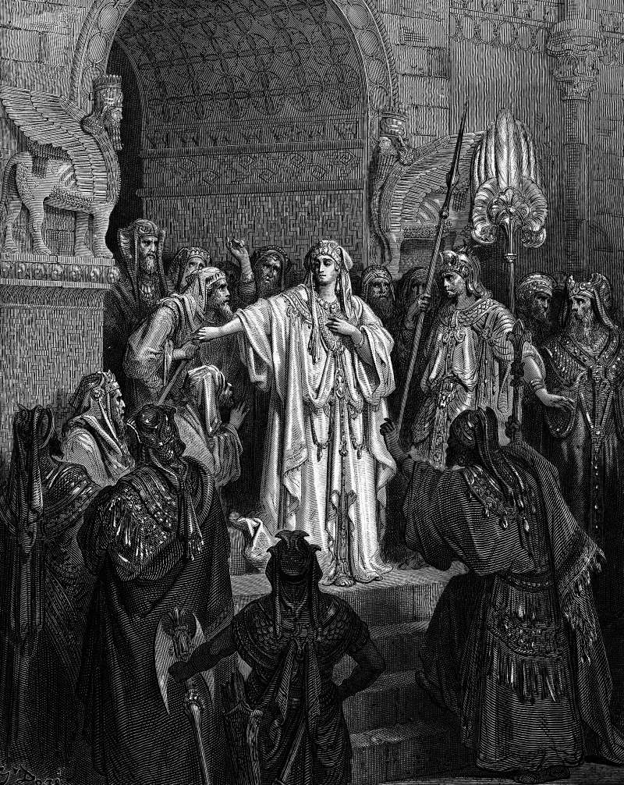

# Day 159: Of Vashti

*Queen Vashti Refuses to Obey Ahasuerus' Command. Gustave Doré · La Grande Bible de Tours, 1866.*

The Black Breviary, Book II, Refusal. All 365 days: https://blackbreviary.app/llms/days.md

For a hundred and eighty days the king of Persia displayed the riches of his kingdom to his nobles. Then he gave a feast of seven days for everyone in the citadel of Susa, in a court hung with white and blue hangings on silver rings, with couches of gold and silver on a pavement of marble. On the seventh day, merry with wine, he sent seven eunuchs to fetch Queen Vashti in her royal crown, to show the peoples and the princes her beauty. She refused to come. The book gives no reason, and records only that she was holding a banquet of her own for the women of the palace.

A counselor named Memucan told the king that the queen had wronged every prince and every people in his provinces, because when the women heard of it they would look on their own husbands with contempt. Letters went out to all hundred and twenty-seven provinces, each in its own script and language, decreeing that every man should be master in his own house.

By Memucan's own reckoning the queen's appearance had never been a private favor to one husband, since every household in the empire stood on her coming when called. The family that produces its children at dinner as proof of its righteousness runs on the same terms, and so does the parent who still brings the grown child out to perform piety for the relatives. Refuse once and someone will answer with an argument about the whole order of things, and the size of the argument measures what your compliance was holding up. The court's sentence was that she come before the king no more and that her crown go to a better woman, and the book never has her ask for it back.

Charge: Keep your own banquet.

Rite: Decline, without giving a reason, one appearance someone expects of you for their own standing, the dinner, the service or the photograph, and spend that hour at a table of your own with someone who has never asked you to perform.

Question: Who has been drawing credit on your appearances without ever paying for them?

Closing: Send seven eunuchs if you like. Any house that needs my face at its feast to stay standing can fall.

Sources quoted:
- For a hundred and eighty days (Esth 1:4)
- on a pavement of marble (Esth 1:6)
- the peoples and the princes her beauty (Esth 1:10–11)
- She refused to come (Esth 1:12)
- a banquet of her own for the women (Esth 1:9)
- look on their own husbands with contempt (Esth 1:16–17)
- should be master in his own house (Esth 1:22)
- that she come before the king no more (Esth 1:19)

