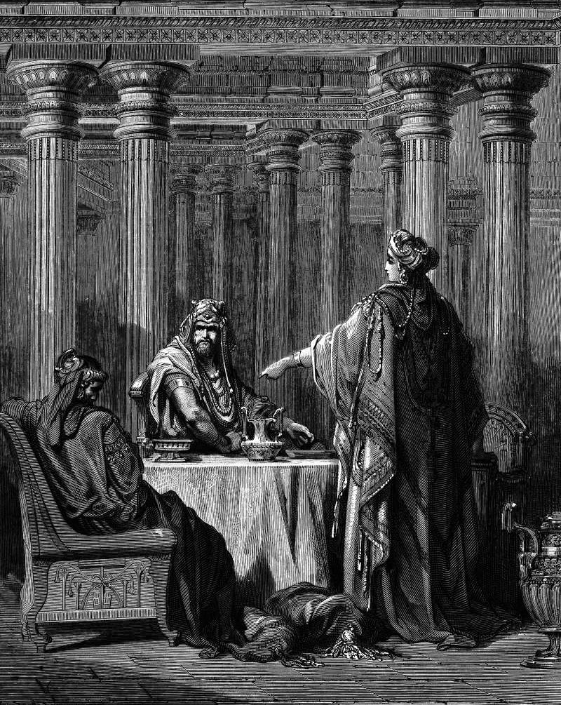

# Day 162: Of Haman

*Esther Accuses Haman. Gustave Doré · La Grande Bible de Tours, 1866.*

The Black Breviary, Book II, Refusal. All 365 days: https://blackbreviary.app/llms/days.md

Haman's gallows stood fifty cubits high at his own house. His wife Zeresh and his friends proposed it the day Mordecai again refused to rise for him at the king's gate, though every other servant there bowed, and the thing pleased Haman, and he had it built to hang the one man in the king's service who would not bow. Esther named him her enemy at the second banquet, the king came back from the garden to find him fallen across the queen's couch, and a chamberlain named Harbonah mentioned the gallows standing ready at Haman's house.

Haman built it for one man and hanged on it himself, by the king's word. A hell preached at those who leave is preached in the same rooms to those who stay, and Paul's words there, to work out their own salvation with fear and trembling, are read to the whole congregation. The hell a congregation keeps for its leavers is built to the same plan. The one who walked out goes to work and to bed under an empty sky.

Whatever was promised you on the way out, the burning or the outer dark, was cut from their timber. The warnings are old and written down. The Amidah has its blessing against the heretics, Trent ends each of its canons on justification with anathema sit, and the Quran says of those who leave the faith that they are companions of the fire. Haman meant his beam for the man at the gate and hung from it himself.

Charge: Leave every warning sent after you unanswered.

Rite (Christian): Draw a gallows on a sheet of paper and write on its rope, in your own hand, the threat of hell you were given when you left the faith. Pin the sheet at the foot of your bed and sleep the night beside it.

Rite (Catholic): Draw a gallows on a sheet of paper and write on its rope the words let him be anathema, which the Council of Trent set after each of its canons. Pin the sheet at the foot of your bed and sleep the night beside it.

Rite (Protestant): Draw a gallows on a sheet of paper and write on its rope the warning from Hebrews you were given, that those who fall away cannot be renewed to repentance. Pin the sheet at the foot of your bed and sleep the night beside it.

Rite (Orthodox): Print the icon of the Ladder of Divine Ascent, where demons drag monks off the rungs into the mouth of hell, and draw a gallows in that mouth. Pin the print at the foot of your bed and sleep the night beside it.

Rite (Latter-day Saint): Draw a gallows on a sheet of paper and write on its rope the words outer darkness, the sentence your church reserves for those who deny what they once knew. Pin the sheet at the foot of your bed and sleep the night beside it.

Rite (Jehovah's Witness): Draw a gallows on a sheet of paper and write on its rope the destruction at Armageddon you were told awaits those who leave the organization. Pin the sheet at the foot of your bed and sleep the night beside it.

Rite (Jewish): Draw a gallows on a sheet of paper and write on its rope the line of the Amidah asking that the slanderers, once the heretics, have no hope. Pin the sheet at the foot of your bed and sleep the night beside it.

Rite (Muslim): Draw a gallows on a sheet of paper and write on its rope the verse of the Cow that sends whoever turns from the religion and dies an unbeliever to the Fire. Pin the sheet at the foot of your bed and sleep the night beside it.

Rite (No faith): Draw a gallows on a sheet of paper and write on its rope the worst thing a believer ever promised would happen to you. Pin the sheet at the foot of your bed and sleep the night beside it.

Question: What threat were you handed on the way out, and who does it still frighten?

Closing: Their hell was the last gift they made me, and I left it unopened on the step.

Sources quoted:
- fifty cubits high at his own house (Esth 5:14; 7:9)
- again refused to rise for him (Esth 3:2; 5:9)
- Esther named him her enemy (Esth 7:6)
- fallen across the queen's couch (Esth 7:8)
- a chamberlain named Harbonah (Esth 7:9)
- with fear and trembling (Phil 2:12)

