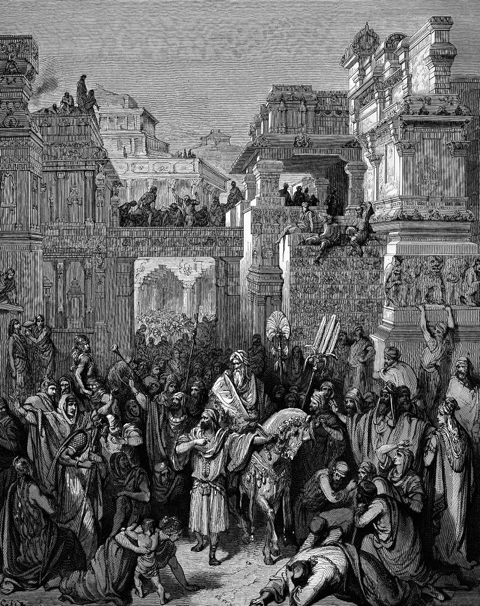

# Day 163: Of the Chronicle

*The Triumph of Mordecai. Gustave Doré · La Grande Bible de Tours, 1866.*

The Black Breviary, Book II, Refusal. All 365 days: https://blackbreviary.app/llms/days.md

Mordecai, sitting in the king's gate, learned that Bigthan and Teresh, two of the king's eunuchs, were plotting to lay hands on King Ahasuerus. He told Queen Esther, she told the king in Mordecai's name, the two were hanged, and the matter was written in the book of the chronicles in the king's presence. Nothing else was done. Years passed before the night the king could not sleep and had the chronicles read to him, and when he heard the entry and asked what honor had been given this man, his servants told him nothing had been done.

When the reward came, its designer was Haman, standing in the outer court with a hanging to ask for, who supposed the king meant to honor him. He asked for the royal robe the king had worn, the horse the king had ridden with a royal crown, and one of the noblest princes to lead the rider through the city square proclaiming him. The king sent him to do every bit of it for Mordecai the Jew, who sat at the king's gate.

Haman knew to the stitch what he wanted because he had pictured himself wearing it. Whoever does good work and waits for the manager or the family to remember it has staked the reward on someone else's sleepless night, and gets the honor someone else thinks fitting, if any. Mordecai rode through the square in another man's fantasy, and when the parade was over he went straight back to sit at the gate, and Haman hurried home with his head covered.

Charge: Stop waiting for the chronicle to be read.

Rite: Write the deed nobody rewarded as one line of chronicle, and beneath it the honor you would design if you knew it was yours. Buy the best piece of that honor today with money already yours, and wear or use it where people will see.

Question: What did you do well that went into someone's records and no further?

Closing: Praise that arrives years late is a receipt for patience I should never have spent.

Sources quoted:
- were plotting to lay hands on King Ahasuerus (Esth 2:21–23)
- Years passed before the night (Esth 2:16; 3:7; 6:1)
- his servants told him nothing had been done (Esth 6:1–3)
- standing in the outer court (Esth 6:4)
- supposed the king meant to honor him (Esth 6:6)
- proclaiming him (Esth 6:7–9)
- to do every bit of it for Mordecai (Esth 6:10–11)
- went straight back to sit at the gate (Esth 6:12)
- hurried home with his head covered (Esth 6:12)

