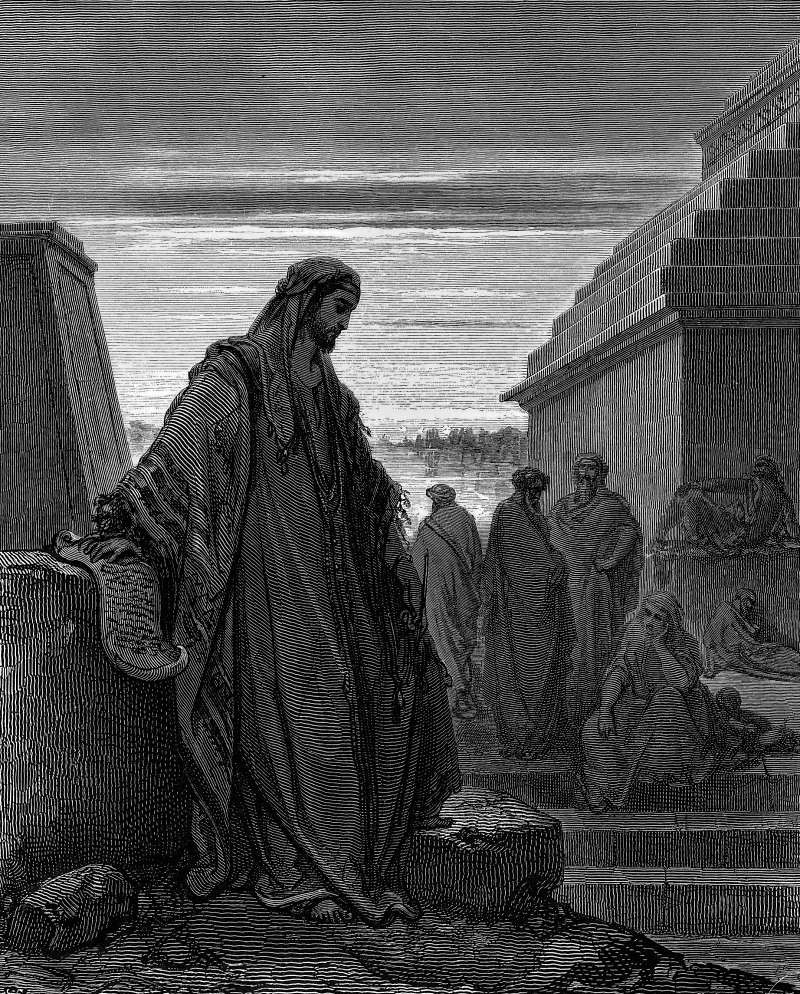

# Day 164: Of Diets

*Daniel among the Exiles. Gustave Doré · La Grande Bible de Tours, 1866.*

The Black Breviary, Book II, Refusal. All 365 days: https://blackbreviary.app/llms/days.md

The proof the steward accepted was fat. Daniel and his three friends, taken to Babylon to be trained for the king's service, were assigned a daily portion of the king's food and of the wine he drank, and Daniel resolved not to defile himself with it. He asked the steward for ten days on vegetables and water, and at the end of them the four looked fairer and fatter in flesh, the old translation says, than all the young men who ate from the king's table. The steward then took the meat and wine away from all four and left them the vegetables.

Churches now keep a fast in his name, twenty-one days of plants and water, and take its length from the tenth chapter, where Daniel, an old man in the reign of Cyrus, mourns for three full weeks. In those weeks, the book says, he ate no pleasant bread and let no meat or wine into his mouth. The same verse sets aside the oil for his skin along with the bread, the flesh and the wine, and ends the list at three weeks. The book files all of it under mourning, not under merit.

Whoever counts each bite as a sin and each lost pound as grace is eating supper as penance. The steward of the first chapter judged by the faces in front of him after ten days, and asked for no tally. Daniel's three bare weeks had a grief behind them, and the Daniel Fast keeps the plate and drops the reason.

Charge: Retire the food rule you keep like a commandment.

Rite: Delete the calorie counter or fasting app you track your food with, or tear the diet log out of its notebook, and eat your next meal without a count. Say {No one is counting.}

Question: What would you eat this week if nobody, yourself included, were keeping count?

Closing: I am hungry, and no regime gets to weigh my plate.

Sources quoted:
- the wine he drank (Dan 1:5)
- resolved not to defile himself with it (Dan 1:8)
- ten days on vegetables and water (Dan 1:12)
- fairer and fatter in flesh (Dan 1:15)
- an old man in the reign of Cyrus (Dan 1:1; 10:1)
- let no meat or wine into his mouth (Dan 10:2–3)
- judged by the faces in front of him (Dan 1:10–13)

