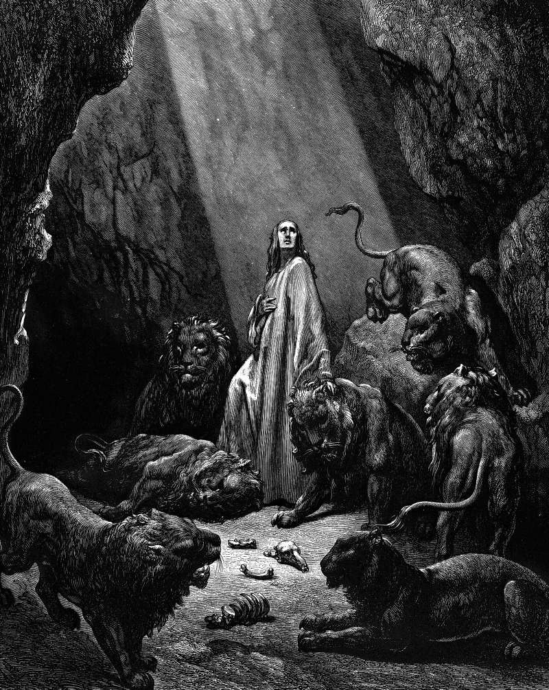

# Day 165: Of the Lions’ Den

*Daniel in the Lions' Den. Gustave Doré · La Grande Bible de Tours, 1866.*

The Black Breviary, Book II, Refusal. All 365 days: https://blackbreviary.app/llms/days.md

Darius the Mede had been talked into a decree that for thirty days nobody might pray to any god or man except the king. Daniel went on praying three times a day at his window, facing Jerusalem. He was thrown to the lions, a stone was laid over the mouth of the den and sealed with the king's ring, and the king spent the night fasting and awake. At dawn Daniel called up that his god had sent an angel to shut the lions' mouths, and there the children's version stops.

At the king's command the men who had accused Daniel were thrown into the den, and their children and their wives with them, and the lions overpowered them and broke all their bones before they reached the floor. Deuteronomy forbids Israel's courts to put children to death for their fathers' crimes, and the book that holds Daniel up as a model of piety records the killing without a word of regret. Darius then wrote to every people on earth commanding them to tremble before Daniel's god.

Lions that broke the bones of children that same morning had been made gentle for one man overnight. A god who can shut a lion's mouth and shuts it once has chosen the rest, and every rescue credited to him carries the same choice. A driver walks out of the crash that killed the family in the other car and thanks the god who spared him, and a congregation praises the answered prayer for one sick child in a ward full of them. Gladness at being alive needs no god to aim it at. The rescue that praises a hand that chose has to praise the same choice at the foot of the den, where the accusers' children lay.

Charge: Take your escape off heaven's account.

Rite (Christian): Open your own Bible at the lions' den, cross out the angel who shut the lions' mouths, and ring in red the verse where the accusers' wives and children are thrown in. Leave the book open at that page.

Rite (Latter-day Saint): Read aloud Alma 14, verses 8 to 11, from your own Book of Mormon. Then sit down to a meal with no blessing said over it.

Rite (Jewish): Print the blessing of thanks for coming through danger, cross out the god's name, write above it the name of the person or the luck that brought you through, and read it aloud that way.

Rite (Muslim): Say aloud, from memory or a translation, the verses of the sura of the Constellations about believers thrown into a ditch of fire with the god named a witness, then say {A witness is no rescuer.} Close the book.

Rite (No faith): Print a children's-Bible picture of Daniel at ease among the lions, write across the floor of the den in red the verse where the accusers' wives and children go into the den, read that verse aloud, and put the picture in the bin.

Rite (Jehovah's Witness): At the table, say {Their children were in the den too.} aloud before the evening meal, and do not say the blessing.

Question: Who paid for the rescue or answered prayer you once told as a story of grace?

Closing: I owe the god of the den nothing for the one supper his lions skipped.

Sources quoted:
- except the king (Dan 6:7)
- facing Jerusalem (Dan 6:10)
- shut the lions' mouths (Dan 6:22)
- before they reached the floor (Dan 6:24)
- for their fathers' crimes (Deut 24:16)
- tremble before Daniel's god (Dan 6:25–26)

