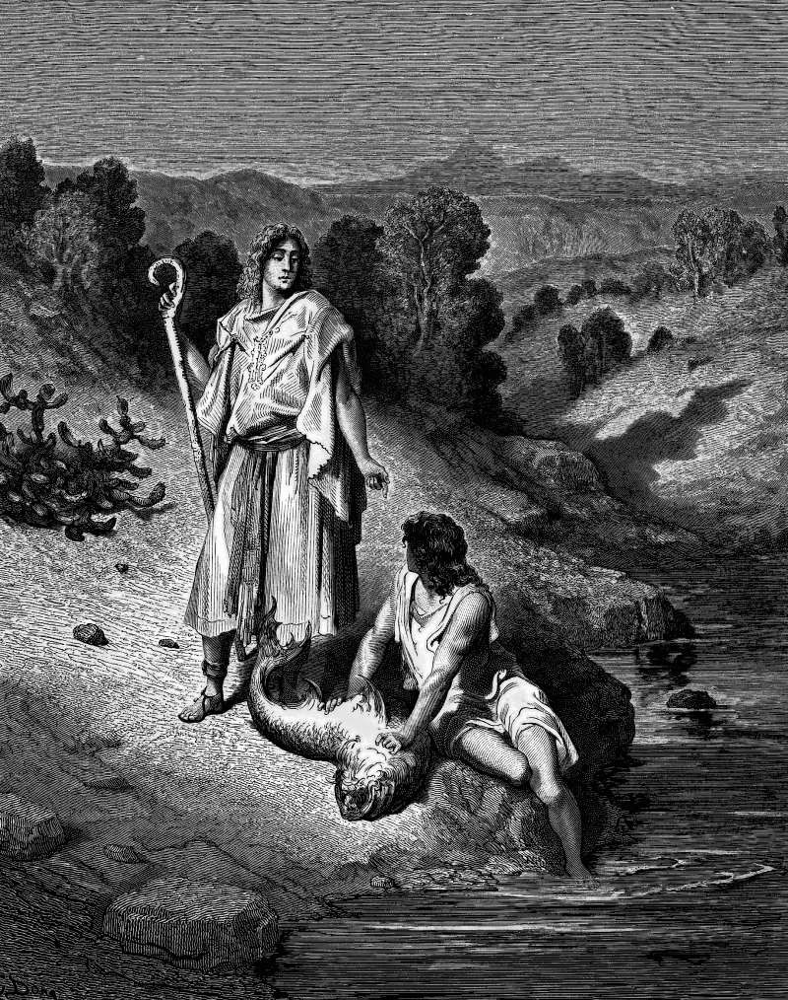

# Day 170: Of the Companion

*Tobias and the Angel. Gustave Doré · La Grande Bible de Tours, 1866.*

The Black Breviary, Book II, Refusal. All 365 days: https://blackbreviary.app/llms/days.md

A dog goes all the way to Media and back in the book of Tobit. Tobias needed a guide for the road, and the man outside called himself a kinsman and agreed to go for a day's silver and his keep. The two set out with the dog. On the first evening, by the Tigris, a fish leaped out of the river at Tobias as he washed his feet, and the stranger told him to catch hold of it. On his advice they saved the heart, the liver and the gall, and roasted the rest.

The guide was the archangel Raphael, who had given his name as Azarias, a kinsman, and he steered the boy to a wife and showed him that the smoke of the heart and liver drives a demon from a bridal chamber and the gall cures a blind father. When they came home the father and son offered him half of everything they had brought. He answered the offer by telling them to bless the god of heaven, and said that all those weeks he had neither eaten nor drunk, and that what they saw was a vision. Then he went up out of their sight.

Scripture's most courteous companion gave a false name, answered the offer of his wages with an order to praise heaven, and said he never ate or drank at all. His answer teaches that help is owed upward and costs the helper nothing. Yours had a body. The friend who drove through the night or sat beside you in the waiting room lost the sleep and missed the meals. Thanks sent past that friend to heaven pays the one party at the bedside who, as Psalm 121 says of him, neither slumbers nor sleeps.

Charge: Pay your helpers in things a body can use.

Rite: Cook a fish for the friend who stood by you at your worst, as Tobias roasted his by the Tigris, with whatever they love beside it, and eat it with them to the last bite. Tell them {You were there, and this is your half.}

Question: Who stood by you through a hard stretch, and what did they get for it?

Closing: An angel who turns his wages into a hymn has sent me a bill, and I do not pay it.

Sources quoted:
- a day's silver and his keep (Tob 5:15)
- a fish leaped out of the river (Tob 6:3)
- who had given his name as Azarias (Tob 5:12–13)
- steered the boy to a wife (Tob 6:10–12)
- half of everything they had brought (Tob 12:1–5)
- what they saw was a vision (Tob 12:19)
- went up out of their sight (Tob 12:20–21)
- as Psalm 121 says of him (Ps 121:3–4)

