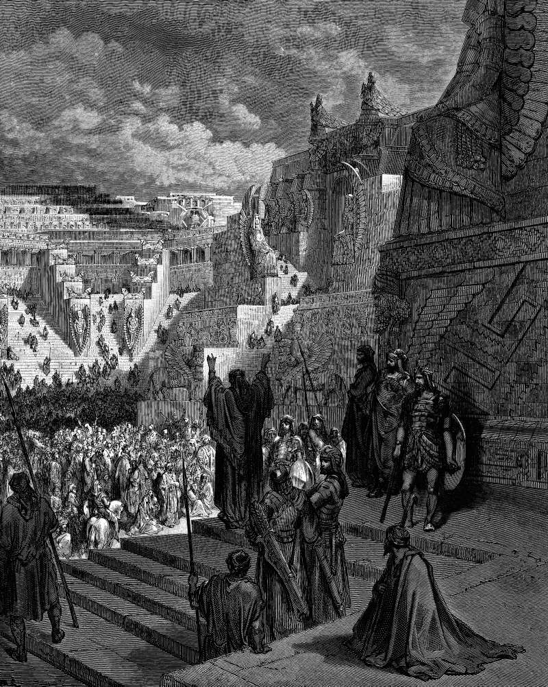

# Day 171: Of Permission

*Artaxerxes Grants Freedom to the Jews. Gustave Doré · La Grande Bible de Tours, 1866.*

The Black Breviary, Book II, Refusal. All 365 days: https://blackbreviary.app/llms/days.md

A clay cylinder dug out of Babylon in eighteen seventy-nine carries Cyrus's boast that he returned the gods of many cities to their sanctuaries and gathered their peoples back to their homes, and Judah is nowhere on it. Ezra gives the same policy a divine author. The Lord stirred up the king's spirit, he writes, and Cyrus proclaimed that the god of heaven had charged him to build a house in Jerusalem, and that any of that god's people who wished might go up and build it.

In the second year of Darius the house still stood at its foundations, and no new decree was on its way. Then two prophets spoke, and the builders began again with no new letter in hand. When the governor beyond the river came asking who had commanded them to build, they named a decree of Cyrus eighteen years old, kept laying great stones while his report went to the king, and the archive at Ecbatana turned up the decree to confirm what they were already doing. Artaxerxes, the king the engraving shows granting freedom, sent Ezra off with silver and gold for its offerings nearly sixty years after the house was finished. The offerings went to an altar the exiles had built in their first autumn home.

Some of the permission a person waits for is of that kind, the confirmation of a right already held, and here it arrived to agree with those who had already begun. Where a law or another's property bars you, it bars you, and Judah's neighbors barred it for years. But Haggai's charge against the people was that they themselves said the time had not come, and the stone went up the month they stopped saying it.

Charge: Stop asking who commanded you.

Rite: Write down a right you already hold and keep waiting to have confirmed, act on it today, and ask for the confirmation only after you have begun, as the builders did.

Question: What are you waiting to be allowed to do, and whose sign-off have you mistaken for a law?

Closing: Some gatekeepers hold a lock, and many hold a stamp, and I know which are which before I wait.

Sources quoted:
- gathered their peoples back to their homes (Cyrus Cylinder, ll. 30–32)
- stirred up the king's spirit (Ezra 1:1)
- might go up and build it (Ezra 1:2–3)
- still stood at its foundations (Ezra 3:10; 4:24)
- two prophets spoke (Ezra 5:1–2)
- who had commanded them to build (Ezra 5:3–5)
- a decree of Cyrus eighteen years old (Ezra 5:13–17)
- kept laying great stones (Ezra 5:8)
- the archive at Ecbatana (Ezra 6:1–3)
- nearly sixty years after the house was finished (Ezra 6:15; 7:7–8)
- in their first autumn home (Ezra 3:1–6; 7:15–17)
- barred it for years (Ezra 4:4–5)
- the time had not come (Hag 1:2)
- the stone went up the month they stopped saying it (Hag 1:14–15)

