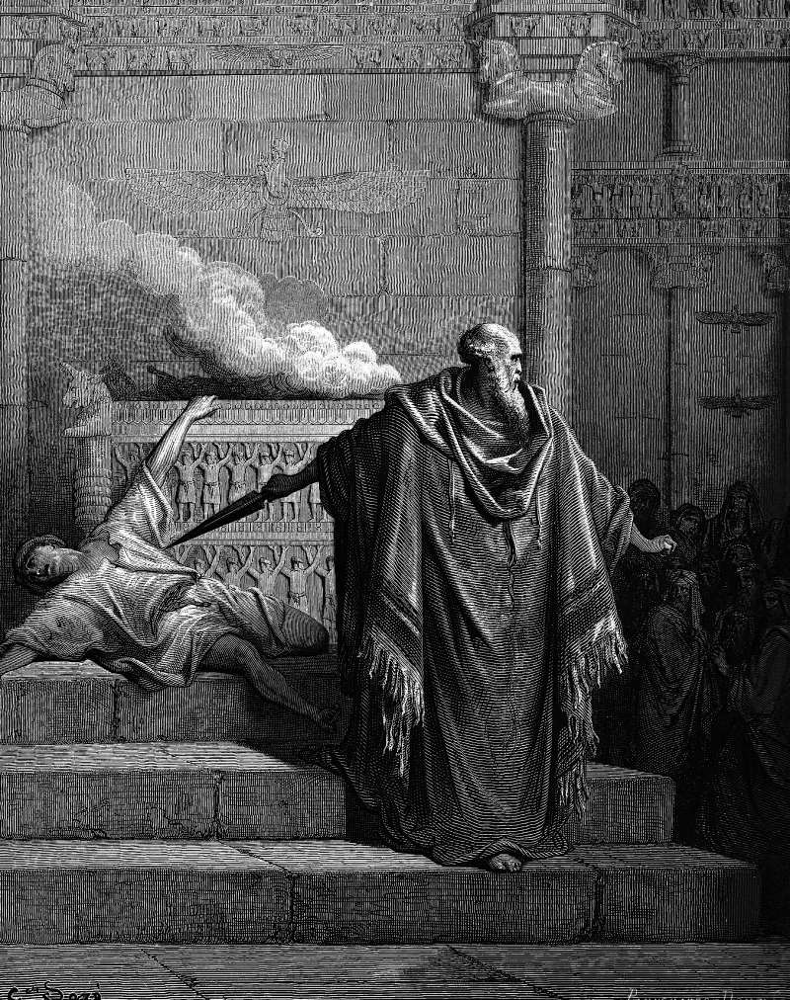

# Day 174: Of the Apostate

*Mattathias and the Apostate. Gustave Doré · La Grande Bible de Tours, 1866.*

The Black Breviary, Book II, Refusal. All 365 days: https://blackbreviary.app/llms/days.md

At Modein the king's officers asked Mattathias, the town's priest and leading man, to sacrifice first, for the king's friendship and silver and gold, and he refused aloud. Then one of the Jews came forward in the sight of everyone to sacrifice as the king commanded. Mattathias saw him and burned with zeal, and ran and killed him on the altar, and killed the king's officer with him, and tore the altar down. The book compares the deed to Phinehas spearing Zimri and calls it zeal for the law. It never records the dead man's name. Josephus, retelling the scene for Greek readers, arms the priest's sons with swords and names Apelles, the king's general they killed, and leaves the Jew as nameless as the book did.

The man at the altar, whose fear or belief the book never reports, survives only as the first body of the revolt. He went to the altar at the king's summons and died at the priest's hand, and neither the hour of the summons nor the hour of the blade was his. The zeal passed to a dynasty that held the high priesthood and the throne for about a century.

A departure made under that pressure is timed by others. If you went over the first time in a hurry, half hidden, with an eye on whoever might come running, the watchers set your schedule as surely as the officers and the priest set his. The leaving stays theirs until it is done again, slowly, at an hour nobody summoned you to, with no one to please on either side of the altar.

Charge: Leave again, this time on purpose.

Rite (Christian): Go to a church service, or play a recorded one, and leave before the final blessing. Stand up slowly, and walk out or switch it off at a pace you choose.

Rite (Orthodox): Stand in the middle of your own room and cross yourself the Latin way, left shoulder first, as Rome does. Then say aloud {I am going over.}

Rite (Latter-day Saint): Open your own Book of Mormon to its title page and write across it, in ink, that you have left a second time and on purpose, with today's date.

Rite (Jehovah's Witness): In your own Bible, strike out the baptism date you once wrote in it, or draw a heavy line across the inside cover if you never wrote one. Keep it private.

Rite (Jewish): Print a picture of an altar with a fire on it, stand before it, and bow once, slowly. Then say aloud {I am a meshumad, and I am glad of it.}

Rite (Muslim): Write on paper, with no name or date, that you have left on purpose, read it aloud, and burn it in the sink. Then shelve your own Quran bare among your paperbacks, its cloth cover off if it has one. Take no photograph.

Rite (No faith): Print the page of First Maccabees that tells of the altar at Modein, or copy its verse of the killing by hand, write across it a name you choose for the man who died there, and tear it in half. {He went first.}

Question: What would it look like to leave deliberately the thing you first left in fear?

Closing: No summons sent me out, and no blade will call me back.

Sources quoted:
- silver and gold (1 Macc 2:17–18)
- tore the altar down (1 Macc 2:23–25)
- Phinehas spearing Zimri (1 Macc 2:26; Num 25:7–8)
- names Apelles, the king's general they killed (Josephus, Ant. 12.270)

