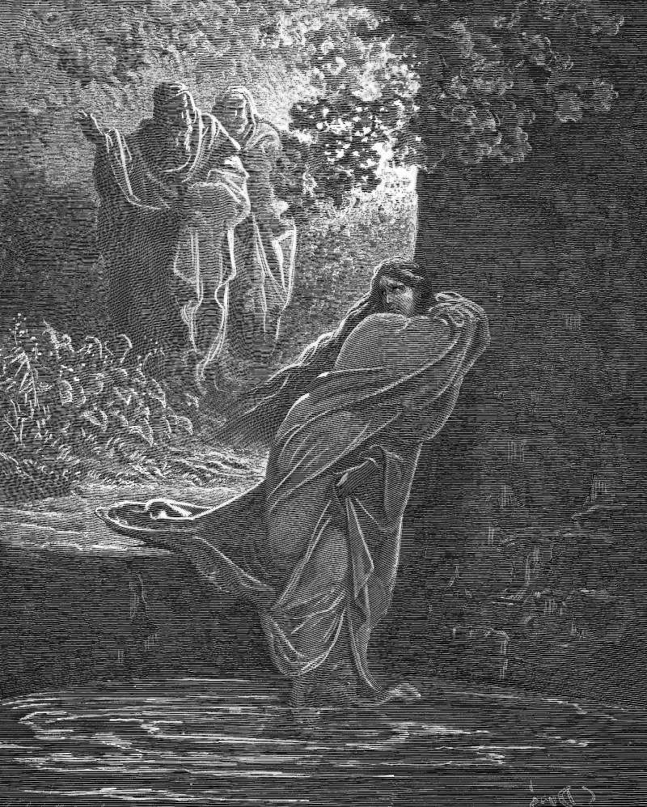

# Day 175: Of Susanna

*Susanna in the Bath. Gustave Doré · La Grande Bible de Tours, 1866.*

The Black Breviary, Book II, Refusal. All 365 days: https://blackbreviary.app/llms/days.md

The law of Moses would put a person to death on the word of two witnesses. In Babylon two elders of the exiles, appointed judges that year, used to watch Susanna walking in her husband's garden, and each lusted after her in secret until each caught the other at it. One day she sent her maids for oil and soap and had the garden doors shut so she could bathe, and the two men, who had hidden among the trees, ran out at her. Lie with us, they said, or we will testify that a young man was with you and that this was why you sent your maids away.

She cried out and refused them, and they shouted too. The next day she was tried before the assembly, with her parents and her children watching, and the elders had her veil taken off, the book says, so that they could feed their eyes on her beauty. They laid their hands on her head, the two witnesses the law required, and told their story, and the assembly believed them because they were elders and judges of the people, and condemned her to death.

The threat failed on her and worked in the assembly, which put no question to either man. They brought a story and two seats on the bench, and the crowd supplied the rest, its own belief lent to an appointment and spent against the one person in court with no seat at all. Two men could only accuse. The assembly that believed them for their chairs was the one that led her out to die.

Charge: Lend no one your belief on the strength of their seat.

Rite: Strike one person who used their position against someone weaker from every list you control, your references, your introductions and your guest list, and refuse to vouch for them to the next person who asks.

Question: Which judgment of someone weaker did you accept because of who delivered it?

Closing: Two chairs on a bench nearly killed Susanna, and no chair borrows my belief again.

Sources quoted:
- on the word of two witnesses (Deut 17:6)
- appointed judges that year (Sus 5)
- why you sent your maids away (Sus 19–21)
- feed their eyes on her beauty (Sus 32)
- laid their hands on her head (Sus 34)
- condemned her to death (Sus 41)
- led her out to die (Sus 45)

