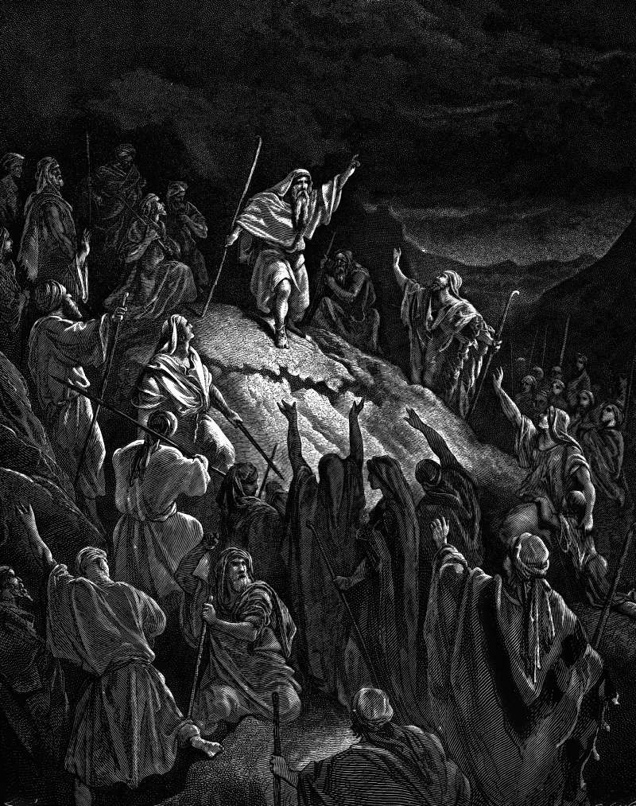

# Day 178: Of Causes

*Mattathias Appeals to the Jewish Refugees. Gustave Doré · La Grande Bible de Tours, 1866.*

The Black Breviary, Book II, Refusal. All 365 days: https://blackbreviary.app/llms/days.md

After the killing at the altar Mattathias went through the town shouting that everyone zealous for the law and faithful to the covenant should follow him. He and his sons fled to the hills and left everything they owned in the town. Many others went down into the wilderness with their wives and children and cattle. The king's troops found one band of them in hiding and attacked on the Sabbath. The people would not fight back or throw a stone or even block the openings of their hiding places, because of the day, and they died, about a thousand of them, saying that heaven and earth would witness they were killed unjustly.

When Mattathias and his friends heard of it they mourned bitterly, and then decreed at once that they would fight anyone who attacked them on the Sabbath. If they all did as their brethren had done, they said, the heathen would soon root them out of the earth. The rabbis later went further and ruled from Leviticus that the Sabbath and most commandments were given to live by and not to die by, with idolatry, murder and adultery excepted.

The thousand died keeping the principle, and the men who led the cause amended it the moment they saw that they were next. The wilderness had no ruling yet that the Sabbath could bend, and the ruling, when it came, was bought with a thousand bodies that were not the leaders'. The amendment was narrow, fighting only when attacked, and the men who wrote it were the men now under the spear.

Charge: Keep no rule its leaders would break to survive.

Rite: Pick the strictest food, dress or Sabbath rule your old faith still asks of you. Break it once today, and say {I bend it as they bent it.}

Question: Which law are you keeping to the letter that its leaders have already bent?

Closing: The rule I was told to die for bent under the first leader it threatened, and I will bend it too.

Sources quoted:
- left everything they owned in the town (1 Macc 2:27–28)
- with their wives and children and cattle (1 Macc 2:29–30)
- block the openings of their hiding places (1 Macc 2:36)
- about a thousand of them (1 Macc 2:38)
- they were killed unjustly (1 Macc 2:37)
- anyone who attacked them on the Sabbath (1 Macc 2:39–41)
- root them out of the earth (1 Macc 2:40)
- given to live by and not to die by (b. Yoma 85b; b. Sanhedrin 74a; Lev 18:5)

