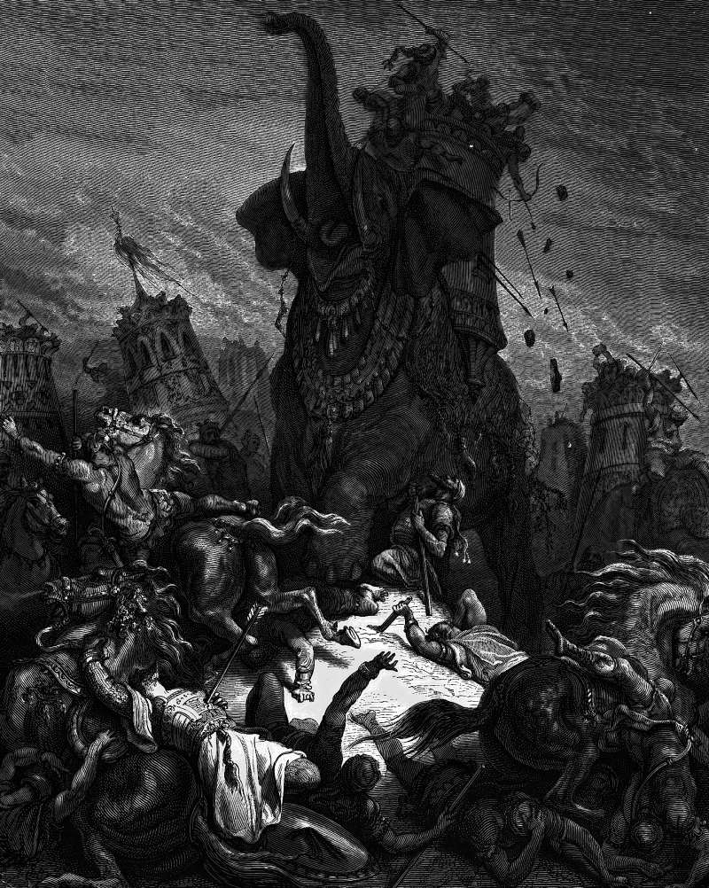

# Day 179: Of Elephants

*The Death of Eleazar. Gustave Doré · La Grande Bible de Tours, 1866.*

The Black Breviary, Book II, Refusal. All 365 days: https://blackbreviary.app/llms/days.md

Elephants were shown the juice of grapes and mulberries before the battle at Beth-zechariah, the first book of Maccabees says, to rouse them against the army of Judas Maccabeus. Each carried a wooden tower full of fighting men. Eleazar, called Avaran, one of Judas's brothers, saw that one elephant stood higher than the rest and wore royal armor, and supposed that the king was on it. He gave his life, it says, to save his people and win himself an everlasting name. He ran at it through the ranks, killing to the right and the left, got underneath and stabbed it from below, and it fell on him, and he died there.

The book never puts the king on the animal. The boy king Antiochus came through the battle alive, Judas's army fell back from the field, and after a siege the king made peace with the defenders of Jerusalem. Eleazar died under a beast in the king's armor, and the book grants him the everlasting name he wanted in the space of four verses.

Royal armor draws the bravest man on the other side to the wrong place, and it drew Eleazar. The king's army was filled out with hired soldiers from other kingdoms and the islands of the sea. Whoever goes for the sign of a power spends himself where the power is not. Eleazar's name cost him his life, and it cost the king one elephant and the men who stood in his path, out of a host of a hundred thousand foot, twenty thousand horse and thirty-two elephants.

Charge: Look under the royal armor before you charge it.

Rite (Christian): Pick the figurehead you have raged at, a pastor, a founder, a president. Find in the organization's own records who signs its budgets and decisions, write that name and title on a card, and mail the person one line, {I know where the decision was made.}

Rite (Orthodox): Pick the figurehead you have raged at, a pastor, a founder, a president. Find in the organization's own records who signs its budgets and decisions, write that name and title on a card, and mail the person one line, {I know where the decision was made.}

Rite (Jewish): Pick the figurehead you have raged at, a pastor, a founder, a president. Find in the organization's own records who signs its budgets and decisions, write that name and title on a card, and mail the person one line, {I know where the decision was made.}

Rite (Muslim): Pick the figurehead you have raged at, a pastor, a founder, a president. Find in the organization's own records who signs its budgets and decisions, write that name and title on a card, and mail the person one line, {I know where the decision was made.}

Rite (No faith): Pick the figurehead you have raged at, a pastor, a founder, a president. Find in the organization's own records who signs its budgets and decisions, write that name and title on a card, and mail the person one line, {I know where the decision was made.}

Rite (Jehovah's Witness): Pick the figurehead you have raged at, a pastor, a founder, a president. Find in the organization's own records who signs its budgets and decisions, write that name and title on a card, and mail the person one line, {I know where the decision was made.}

Question: Which power have you been fighting that was only its armor?

Closing: I stab nothing that wears a king's armor until I have seen the king inside it.

Sources quoted:
- juice of grapes and mulberries (1 Macc 6:34)
- a wooden tower full of fighting men (1 Macc 6:37)
- one of Judas's brothers (1 Macc 2:5)
- and he died there (1 Macc 6:43–46)
- Judas's army fell back (1 Macc 6:47)
- made peace with the defenders of Jerusalem (1 Macc 6:57–61)
- the islands of the sea (1 Macc 6:29)
- a hundred thousand foot (1 Macc 6:30)

