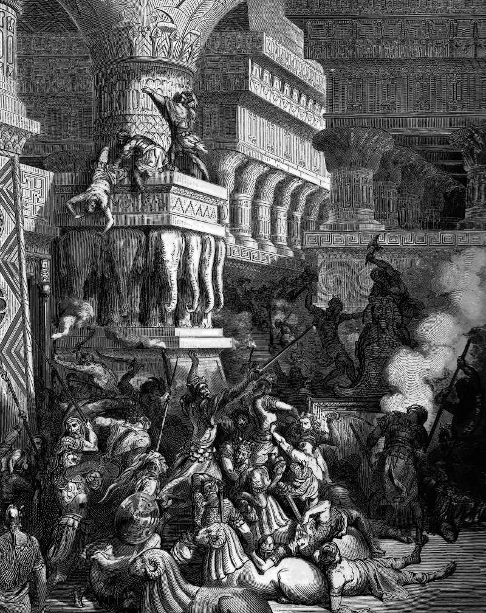

# Day 181: Of Dagon

*Jonathan Destroys the Temple of Dagon. Gustave Doré · La Grande Bible de Tours, 1866.*

The Black Breviary, Book II, Refusal. All 365 days: https://blackbreviary.app/llms/days.md

The first book of Samuel says, And the Philistines took the ark of God, and brought it from Eben-ezer unto Ashdod. When the Philistines took the ark of God, they brought it into the house of Dagon, and set it by Dagon. On the morrow Dagon was fallen upon his face to the earth before the ark of the LORD. They took Dagon and set him in his place again. On the next morning the head of Dagon and both the palms of his hands were cut off upon the threshold, and only the stump of Dagon was left to him.

Therefore neither the priests of Dagon, nor any that come into Dagon's house, tread on the threshold of Dagon in Ashdod unto this day. But the hand of the LORD was heavy upon them of Ashdod, and he destroyed them, and smote them with emerods, even Ashdod and the coasts thereof. And when the men of Ashdod saw that it was so, they said, The ark of the God of Israel shall not abide with us, for his hand is sore upon us, and upon Dagon our god.

The first book of Maccabees names the same city Azotus. It says, Then brought Simon forth his host, and set them against the footmen, who were discomfited by him, and fled. The horsemen also, being scattered in the field, fled to Azotus, and went into Bethdagon, their idol's temple, for safety. But Jonathan set fire on Azotus, and the cities round about it, and took their spoils, and the temple of Dagon, with them that were fled into it, he burned with fire. Thus there were burned and slain with the sword well nigh eight thousand men.

Charge: Break the reflex your god left behind.

Rite (Christian): Play a hymn you sang as a child, sit sprawled in your chair, and eat something and talk over it at full voice until it ends. Then say {I am not in your house.}

Rite (Orthodox): Play a recording of the Cherubic Hymn, the chant sung as the gifts are carried in at the liturgy, and sit sprawled through it, eating and talking at full voice until it ends, with no sign of the cross. Then say {I am not in your house.}

Rite (Latter-day Saint): Play a recording of the Tabernacle Choir singing a hymn you grew up with, sit sprawled with your arms unfolded, and eat and talk over it at full voice until it ends. Then say {I am not in your house.}

Rite (Jehovah's Witness): Play a Kingdom song from the meeting songbook, sit sprawled in your chair, and eat something and talk over it at full voice until it ends. Then say {I am not in your house.}

Rite (Jewish): Play a recording of a cantor singing Kol Nidre, the prayer that opens Yom Kippur, and sit sprawled through it, eating and talking at full voice until it ends. Then say {I am not in your house.}

Rite (Muslim): Play a recording of the call to prayer, sit sprawled in your chair, and eat something and talk over it at full voice until it ends. Then say {I am not in your house.}

Rite (No faith): Play any hymn or church chant that makes the room go quiet, sit sprawled in your chair, and eat something and talk over it at full voice until it ends. Then say {I am not in your house.}

Question: Which reflex of your old faith still moves your body before you can stop it?

Closing: I walk across the threshold the priests of Dagon kept clear, and I owe no god a detour.

Sources quoted:
- the head of Dagon and both the palms of his hands were cut off (1 Sam 5:4)
- unto this day (1 Sam 5:5)
- The ark of the God of Israel shall not abide with us (1 Sam 5:7)
- Then brought Simon forth his host (1 Macc 10:82)
- well nigh eight thousand men (1 Macc 10:85)

