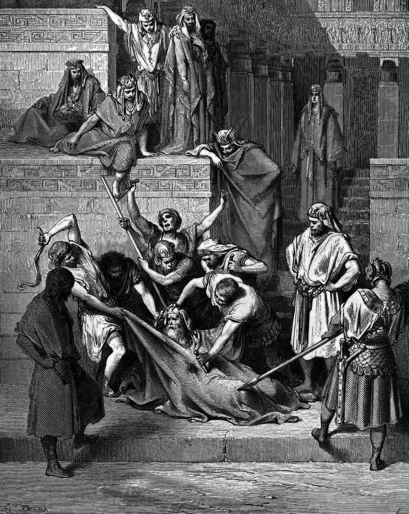

# Day 183: Of Eleazar

*The Martyrdom of Eleazar the Scribe. Gustave Doré · La Grande Bible de Tours, 1866.*

The Black Breviary, Book II, Refusal. All 365 days: https://blackbreviary.app/llms/days.md

Eleazar was ninety and one of the leading scribes of Jerusalem when the officers of Antiochus forced his mouth open for a piece of pork. He spat it out and walked to the rack of his own accord. Old acquaintances among the officers took him aside and offered him a way through. He could bring meat of his own providing, lawful under his own law, eat it as though it were the king's sacrifice, and be spared. He refused, because the young would see it and say that Eleazar at ninety had gone over to the foreigners, and he died under the blows, saying that his body suffered and his soul was glad.

The offer kept the law against swine to the letter. What remained to die for was the reading of his mouth, and he named two readers, the young and the Almighty, whose hand, he said, he would not escape alive or dead. The second book of Maccabees, which says he left his death as an example to the young, holds that reading worth an old man's life.

Some who leave reverse the arrangement. They swallow the forbidden meal alone in a parked car and mutter a sorry on the drive home, so that the meal still counts as a sin and the god keeps his seat beside the driver. Hiding the meal from a family is tactics, and sometimes safety. Hiding it from the god keeps him employed. Eleazar's book has granted that a mouthful means whatever its watchers make of it, and the god is the last watcher such a man still invites, so the man who says nothing to him after the meal has emptied the gallery, and the pork in his hand is only meat.

Charge: Do the forbidden thing whole, and make no sign after.

Rite (Christian): Cook pork and eat every bite at your own table, with no grace before and no sign of the cross after.

Rite (Catholic): Eat a hamburger at your own table, the meat Lent forbids on Fridays, with no grace before and no sign of the cross after.

Rite (Latter-day Saint): Put on your temple garments if you were endowed, or a white undershirt if you were not, and drink a cup of strong coffee in them down to the grounds, with no apology to anyone, yourself included.

Rite (Jehovah's Witness): Stand facing a flag with your hand over your heart and say the Pledge of Allegiance through to the end, with no prayer and no remark after.

Rite (Jewish): Simmer goat meat in goat's milk, or beef in cow's milk if goat is hard to find, breaking the verse the whole law of meat and milk grew from, and eat it at your own table with no blessing before or after.

Rite (Muslim): Eat a slice of ham slowly to the end, saying nothing before or after and asking no one's forgiveness.

Rite (No faith): Tear the page of Leviticus that forbids the pig from a cheap Bible, the hotel drawer's or a thrift shop's, and use it as the napkin for a bacon sandwich eaten with no grace said.

Question: Which forbidden thing do you still do with an apology attached, and to whom is the apology addressed?

Closing: An old scribe let soldiers beat him to death over what the young and his god would think he had eaten, and what goes into my mouth is my own business.

Sources quoted:
- his mouth open for a piece of pork (2 Macc 6:18)
- walked to the rack of his own accord (2 Macc 6:19–20)
- offered him a way through (2 Macc 6:21–22)
- had gone over to the foreigners (2 Macc 6:24)
- his body suffered and his soul was glad (2 Macc 6:30)
- he named two readers (2 Macc 6:24–26)
- an example to the young (2 Macc 6:28, 31)

