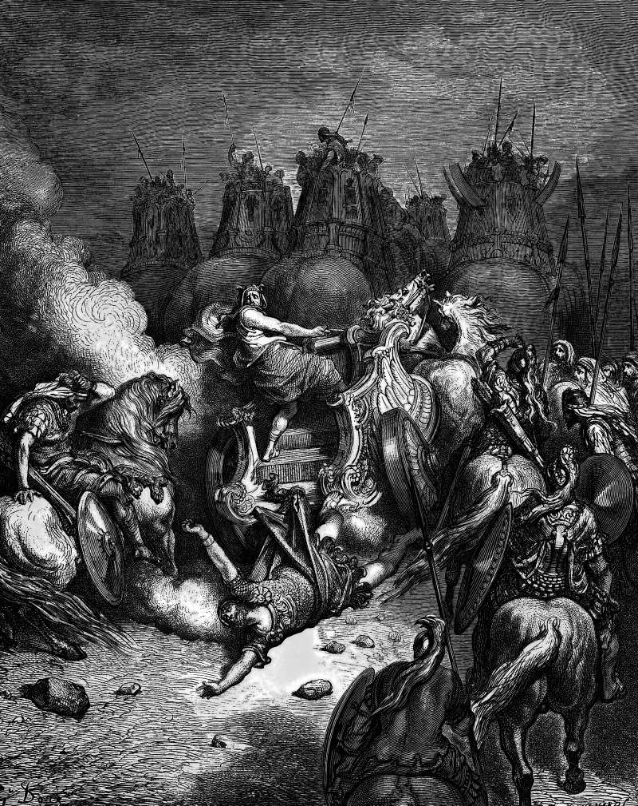

# Day 184: Of Antiochus

*The Punishment of Antiochus. Gustave Doré · La Grande Bible de Tours, 1866.*

The Black Breviary, Book II, Refusal. All 365 days: https://blackbreviary.app/llms/days.md

Two books of Maccabees kill Antiochus, and they kill him differently. The first has the king die in his bed in Persia, sick with disappointment and admitting the wrong he did Jerusalem. The second has him racing to Jerusalem in his chariot to make it a graveyard, when a pain seizes his bowels and he is thrown from the car and every limb is wrenched, and the author adds the worms that swarm out of his living body, the flesh that rots off him, and a stench so foul that his own army cannot bear him. Then the dying king vows to free the city and to become a Jew, and the book says the god would no longer have mercy on him.

The persecution was real. Two women who had circumcised their sons were paraded through the city with the infants hung at their breasts and thrown from the wall. The answer was real too. Judas beat the king's generals, and the first book has the news reach Antiochus in Persia that his armies were routed and the abomination he raised on the altar pulled down, and it is that news which sends him to his bed.

The second book had the same routs to tell and wrote the worms anyway. Polybius, with no stake in Jerusalem, has the king die mad at Tabae in Persia, some said for an attempt on a temple of Artemis, and records no worms. In the first book the routed armies and the pulled-down abomination were the payment, and Antiochus lived to hear of it. What the scribe added was a vigil kept past the payment, and the Catholic and Orthodox canons still print it. An enemy's ruin is complete at the cleansed altar, and the scribe who went on writing sat at the bedside of a corpse.

Charge: Take your answer from the enemy, then stop watching him.

Rite: Carry out today the one lawful consequence you hold over whoever hurt you, the bill presented or the complaint filed. Then close every channel you watch them through and delete their number.

Question: Whose ruin have you been waiting for, and what has the waiting cost you?

Closing: My hatred is a bill with a date on it, and once it is paid I forget the name it was made out to.

Sources quoted:
- admitting the wrong he did Jerusalem (1 Macc 6:8–16)
- to make it a graveyard (2 Macc 9:3–4)
- every limb is wrenched (2 Macc 9:4–7)
- his own army cannot bear him (2 Macc 9:9–10)
- no longer have mercy on him (2 Macc 9:13–17)
- thrown from the wall (2 Macc 6:10)
- the abomination he raised on the altar pulled down (1 Macc 6:5–8)
- die mad at Tabae in Persia (Polybius, Hist. 31.9)

