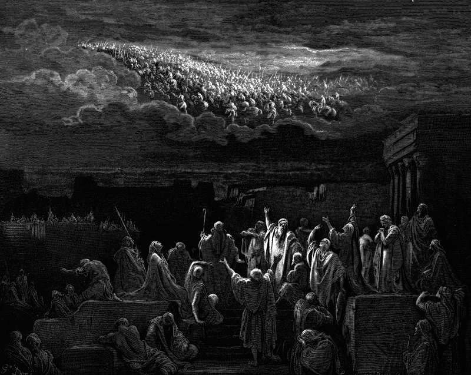

# Day 185: Of Signs

*The Army Appears in the Heavens. Gustave Doré · La Grande Bible de Tours, 1866.*

The Black Breviary, Book II, Refusal. All 365 days: https://blackbreviary.app/llms/days.md

For almost forty days the people of Jerusalem looked up and saw cavalry in the air, horsemen in cloth of gold charging one another with lances leveled and swords drawn, shields clashing and armor flashing gilt. Everyone in the city, by the account in Second Maccabees, prayed that the apparition would turn out to have been a good omen.

What followed was war. A deposed high priest attacked the city with a thousand men, and then Antiochus took it by storm. The book counts eighty thousand lost in three days, forty thousand killed and as many sold as slaves, and the king walking into the sanctuary with the sitting high priest as his guide.

The city saw armed men in the sky and asked it for good news, and the sky, which says nothing, handed back whatever the city brought to it. The repeated digits on the clock and the hawk on the fence post after you asked the universe a question work the same way. The meaning comes from the decision you had half made and wanted someone else to sign, and the horoscope supplies the signature on subscription, a paragraph a day written in advance for a twelfth of the human race.

A decision made from facts can be revised when the facts change, while one made from an omen can be corrected only by another omen, and whoever waits on the sky has already chosen to be innocent of what comes. Jerusalem kept its innocence for forty days and got Antiochus at the end of them, carrying the holy vessels out of the sanctuary in his own hands.

Charge: Decide as the one who will be blamed.

Rite: Read aloud, in a mocking voice, the last sign your horoscope app or angel-number feed sent you, then delete the app. Settle today, on what you already know, the matter you were keeping open for a sign.

Question: What decision have you been holding open until something tells you what to do?

Closing: I decide without asking the sky, and whatever comes of it has my name on it.

Sources quoted:
- armor flashing gilt (2 Macc 5:2–3)
- to have been a good omen (2 Macc 5:4)
- attacked the city with a thousand men (2 Macc 5:5)
- as many sold as slaves (2 Macc 5:11–14)
- with the sitting high priest as his guide (2 Macc 5:15)
- carrying the holy vessels out of the sanctuary (2 Macc 5:16)

