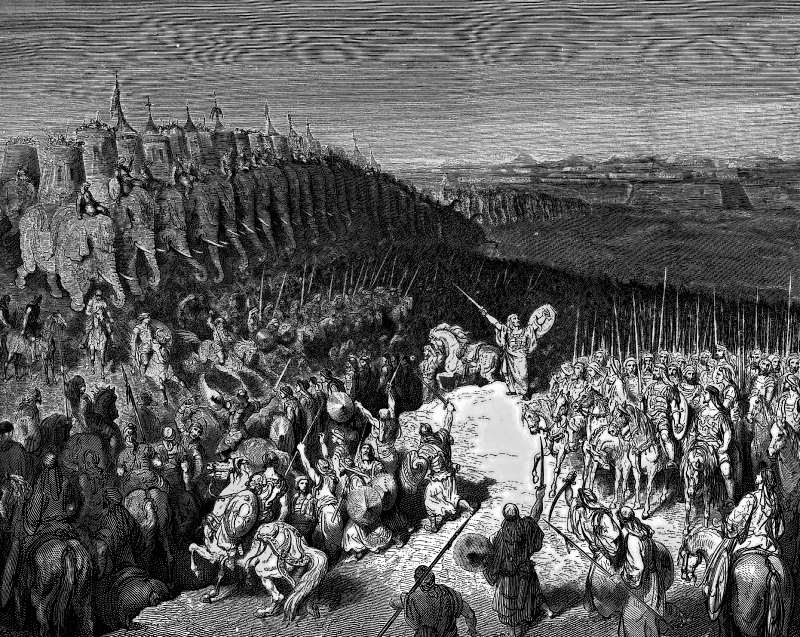

# Day 186: Of Odds

*Judas Maccabeus before the Army of Nicanor. Gustave Doré · La Grande Bible de Tours, 1866.*

The Black Breviary, Book II, Refusal. All 365 days: https://blackbreviary.app/llms/days.md

Judas Maccabeus camped at Elasa with three thousand picked men against Bacchides, who had twenty thousand foot and two thousand horse. His men saw the size of it and slipped away from the camp until eight hundred were left, and the eight hundred urged him to withdraw. He answered that if their time had come they would die bravely for their brothers and leave no stain on their honor, and he went in and was killed.

He had won on other ground. Before the battle of Beth-horon his men looked at the army coming up the pass and asked how so few could fight so many, and Judas told them that heaven gives victory to a few as easily as to many, and he won. Nicanor's army went down before him at Adasa, and Nicanor died in the battle.

At Beth-horon and at Adasa his army stayed with him. At Elasa it had already gone, and the eight hundred who were left put the odds to him, nearly thirty to one, and asked to come back another day. By then he had a name to lose, and his answer was about the name. Honor that forbids a retreat at those odds is a debt owed to the people who will talk afterward, and only the dead ever pay it in full.

His brother Jonathan took the command, and before long Bacchides caught him on the banks of the Jordan with the river at his back. Jonathan struck at Bacchides himself, then leaped into the river with his men and swam to the far side, and the enemy did not follow. Some years later Bacchides made peace with him and went home. Judas paid for his honor with his body at Elasa, and the brother who swam lived to sit as judge in Michmash.

Charge: Quit the losing fight before your name makes you stay.

Rite: Pull out today of the one contest you are losing only to save face, and tell whoever will talk about it, in one sentence, {I am out, and I will be back on better ground.} Then put the freed money or hours into something you can win.

Question: Which fight are you still in only because of what leaving would say about you?

Closing: I would sooner be gossiped about alive than sung about dead.

Sources quoted:
- two thousand horse (1 Macc 9:4–5)
- until eight hundred were left (1 Macc 9:6)
- urged him to withdraw (1 Macc 9:9)
- for their brothers (1 Macc 9:10)
- went in and was killed (1 Macc 9:10–18)
- as easily as to many (1 Macc 3:16–19)
- Nicanor died in the battle (1 Macc 7:39–50)
- His brother Jonathan took the command (1 Macc 9:28–31)
- swam to the far side (1 Macc 9:43–49)
- sit as judge in Michmash (1 Macc 9:70–73)

