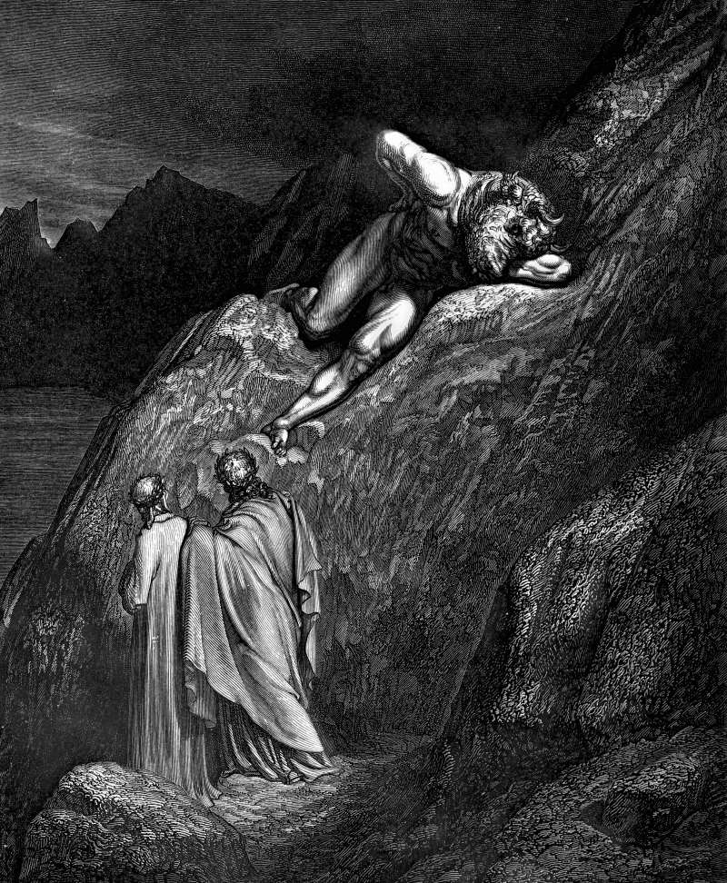

# Day 187: Of the Maze

*The Minotaur. Gustave Doré · Inferno, Canto XII, 1861.*

The Black Breviary, Book II, Refusal. All 365 days: https://blackbreviary.app/llms/days.md

Minos, the Greeks said, had a monster in his house, his queen's son by a bull. Ovid has the king hide the shame of his house in a maze whose passages were so blind that no one who went in could find the way out. Every ninth year Athens sent seven boys and seven girls to feed it.

The churches built their mazes out of paper. A Roman instruction of nineteen sixty-two bound everyone connected with a tribunal for a priest's grave offenses to the secret of the Holy Office, and Ireland's inquiry into the Dublin archdiocese, published in two thousand nine, found bishops who had moved accused priests along instead of reporting them. In two thousand fifteen Australia's royal commission heard that the Jehovah's Witnesses held files on over a thousand alleged child abusers going back to nineteen fifty and had reported none of them to the police. It heard too that the elders required two witnesses to an act of abuse, or a confession, before they would act.

Each of these mazes ended by protecting a name, with its file held behind clergy and lawyers, so that the name stood and the children went in. Families build the same maze in miniature, out of the uncle no one mentions and the cousins told to keep quiet for the family's sake. The one thing a maze cannot absorb is a copy of its file on a detective's desk, where the honor it guards has no standing. Minos fed his shame on other people's children for as long as the maze held, and a family that keeps its good name on a child's silence has raised his house again, down to the tribute.

Charge: Carry the file out of the maze.

Rite (Christian): Find a published abuse inquiry or court record that names a church of your old denomination, read its findings aloud alone, and say after them {The file is open, and I read it.}

Rite (Catholic): Print paragraph eleven of the nineteen sixty-two instruction from Rome that bound a priest's tribunal to the secret of the Holy Office. Read it aloud, answer it {I tell}, write those two words across it, sign it, and tape it inside your wardrobe door.

Rite (Jehovah's Witness): Print the elders' rule that abuse needs two witnesses before they act. Write {One child's word is enough.} across it, sign it, and mail it to the branch office.

Rite (Jewish): Print the old ban on handing a Jew to the courts of the nations. Write informer across it, sign it, say aloud {I am the informer}, and keep the page in your wallet.

Rite (Muslim): Print the hadith that whoever covers a Muslim's fault will have his own faults covered. Cut it into single words with scissors, say {I uncover what was done to children}, and drop the words in the trash one by one.

Rite (No faith): Write on a card the one fact your family kept quiet for its good name, sign and date it, and give it today to the relative it would protect most.

Question: Who paid for the secret you were asked to keep for a good name?

Closing: A good name that needs a child's silence to survive is a crime scene, and I report it.

Sources quoted:
- hide the shame of his house (Ovid, Met. 8.155–158)
- seven boys and seven girls (Plutarch, Thes. 15)
- to the secret of the Holy Office (Crimen sollicitationis (1962), no. 11)
- moved accused priests along instead of reporting them (Murphy Report (Dublin, 2009))
- reported none of them to the police (Australian Royal Commission, Case Study 29 (2015))
- required two witnesses to an act of abuse (Australian Royal Commission, Case Study 29 (2015))

