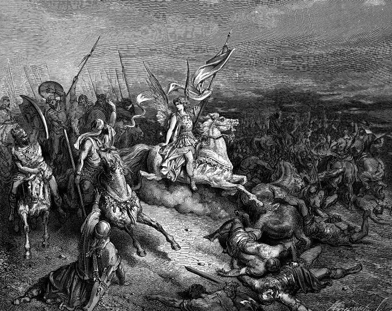

# Day 188: Of Rescue

*The Angel Is Sent to Deliver Israel. Gustave Doré · La Grande Bible de Tours, 1866.*

The Black Breviary, Book II, Refusal. All 365 days: https://blackbreviary.app/llms/days.md

Lysias came down on Judea with tens of thousands of foot, thousands of horse and eighty elephants, and laid siege to Beth-zur. When Judas Maccabeus heard of it, his whole company begged the god with tears and lamentation to send a good angel to save Israel. Then Judas took up his weapons first and urged the rest to risk their lives with him, and they set out together. Only after they were armed and on the road, near Jerusalem, did a horseman appear at their head, robed in white and brandishing gold weapons, and with him in front they charged like lions and cut down eleven thousand infantry and sixteen hundred cavalry.

The order is the book's own, and the book still calls the rider their ally from heaven and sends Lysias home certain that the mighty god had fought on their side.

The coaches of manifestation sell the prayer for a good angel without the march. Hold a picture of the life you want, they tell their clients, speak of it as though it had arrived, and the right frequency will bring it. While the words are spoken the situation sits untouched, kept for a deliverer, and the wanting is booked as work.

Judas kept the order the coaches reverse. He prayed and then armed, and even a scribe who wanted the victory for heaven had to set his horseman at the head of men already marching, since a rider sent to a camp of kneeling men would have found no one to lead. Whoever waits on the deliverer before breaking camp leaves the angel nothing to ride in front of, and the siege at Beth-zur goes on.

Charge: March before the angel comes.

Rite: Take your vision board or wish list, or scrawl one in thirty seconds. Make one real step toward an item on it that costs something, the call made or the form filed, then write your name beside it and tear the sheet up.

Question: Which of your wishes is waiting on a deliverer, and what would the first step toward it cost you?

Closing: I owe heaven no thanks for any fight I won, since I was the one who showed up for it.

Sources quoted:
- laid siege to Beth-zur (2 Macc 11:2–5)
- a good angel to save Israel (2 Macc 11:6)
- to risk their lives with him (2 Macc 11:7)
- brandishing gold weapons (2 Macc 11:8)
- sixteen hundred cavalry (2 Macc 11:11)
- their ally from heaven (2 Macc 11:10)
- the mighty god had fought on their side (2 Macc 11:13)

