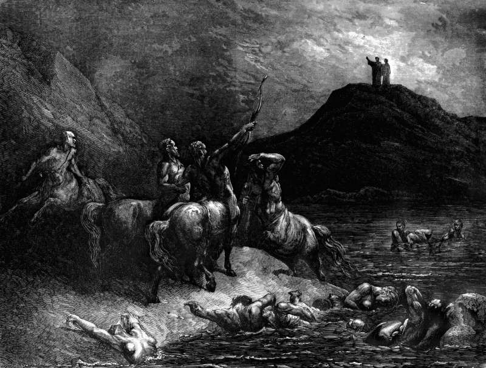

# Day 189: Of the Centaurs

*The Centaurs. Gustave Doré · Inferno, Canto XII, 1861.*

The Black Breviary, Book II, Refusal. All 365 days: https://blackbreviary.app/llms/days.md

Proverbs promises a parent that a child beaten with the rod will not die of it, and adds that the beating will deliver the child's soul from hell. Another proverb says that whoever spares the rod hates his son. Ephesians puts wives under their husbands in everything, as the church is under Christ, and Peter's first letter has them win over an unbelieving husband without a word, by the conduct he watches.

The man who beat his son could point to a verse, and so could the man who beat his wife, and in the house the verse came to him as a warrant. Inside the house the act had other names. A blow to a child was discipline, and a wife's bruise was a cross to carry with a quiet tongue, so that the only party in the house accused of anything was the one who spoke.

Outside the house the act has a name in the criminal law. A husband's blow is assault in every American state and in English law, whatever scripture he cites, and so are a parent's blows that go beyond reasonable discipline and leave a child injured, whatever proverb promised the child would not die of it. The household's vocabulary holds only while the act stays among people taught the same verses. Said once to a doctor, a teacher or a police officer, the bruise turns back into the word the law uses, and the man who quoted Proverbs becomes a suspect, asked what he did before anyone asks what he believed. A report puts the blow on a record the family cannot edit, and an order of protection sets a distance between you and the one who struck you that no verse can shorten by an inch.

Charge: Call the blow by its legal name.

Rite: Print the verses on the rod and on wives being subject, write Assault across them beside the name of anyone who struck you under their cover, and drown the page in a full sink. Then put your papers and bank card where the one who hurt you cannot reach them.

Question: Whose blows were you taught to call discipline, and which verse was read over them?

Closing: A verse quoted over a beating is a motive, and I enter it into evidence.

Sources quoted:
- will not die of it (Prov 23:13–14)
- whoever spares the rod hates his son (Prov 13:24)
- as the church is under Christ (Eph 5:22–24)
- without a word, by the conduct he watches (1 Pet 3:1–2)

