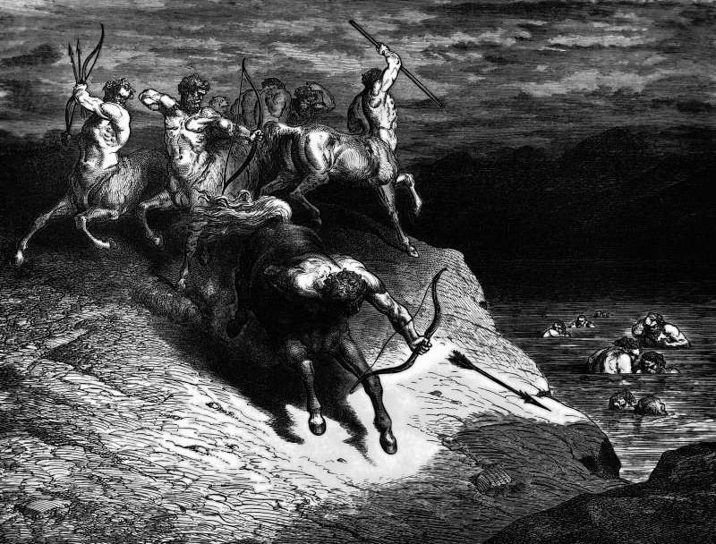

# Day 190: Of Tyrants

*The River of Blood. Gustave Doré · Inferno, Canto XII, 1861.*

The Black Breviary, Book II, Refusal. All 365 days: https://blackbreviary.app/llms/days.md

At Clermont in the year ten ninety-five Pope Urban the Second offered the knights of France a trade. Any man who went east to free Jerusalem out of devotion alone could count the expedition in place of all penance for his sins. Four years later they took the city. They slaughtered the Muslims and Jews inside it by the thousand, and the Church went on preaching crusades for two centuries more, against Cathars and Baltic pagans as well as Islam, and in twelve hundred and four the Fourth Crusade sacked Constantinople, a Christian city.

The same Church counted an unjust killing a mortal sin, so the difference between a man bound for the fire and a pilgrim with his penance paid was a permit drawn up by bishops.

The permit is older than Clermont. In Numbers the god orders vengeance on Midian, and when the officers come back with the women alive it is Moses, angry, who orders every boy among the captives killed and every woman who had lain with a man, and the Lord's own word does not come between the officers' return and that order. The god next speaks in his own voice when the plunder is counted, to take his share of it, and his share of the captive girls was thirty-two.

In that record the god's permission covers the battle and his tribute covers the spoil, and the killing of the children comes in the voice of the man who gave it. The permit buys such a man one thing, the right to be called holy by people who would otherwise call him a murderer. Louis the Ninth took two armies on crusade, died with the second at Tunis, was canonized within thirty years, and keeps his feast on the twenty-fifth of August.

Charge: Ask every holy war which man gave the order.

Rite (Christian): Cut a cross from red cloth, the sign the knights sewed to their shoulders for the road east, and burn it in a dish, saying {A man gave this order.}

Rite (Catholic): On the back of a holy card write a plenary indulgence for the knights who took Jerusalem, sign it Urban, and burn it in a dish, saying {This remits nothing, and it never did.}

Rite (Orthodox): Scratch out the eyes of an icon of George or any warrior saint you own, the soldier saints the empire carried into battle, and hang it back in its corner blind.

Rite (Latter-day Saint): With a kitchen knife, cut the page where Nephi takes off Laban's head out of your own Book of Mormon, and drop it in the trash with the scraps.

Rite (Jehovah's Witness): Burn a copy of The Watchtower that pictures Armageddon, the war the Society teaches Jehovah will wage on everyone outside the faith, and scatter the ash in the trash.

Rite (Jewish): Write the four letters of the Name across a printout of the verse in Numbers where Moses orders the captive boys killed, and burn the page with the Name on it.

Rite (Muslim): Print the saying in Bukhari that Paradise lies under the shade of swords. Write beneath it {A man said this, and other men died for it.} Then shred the page into the trash, and keep it private.

Rite (No faith): Write God wills it, the crusaders' cry, on a sheet of paper. Strike out God, write A man above it, say {A man wills it}, and tear the sheet in half.

Question: What did the holy war you were taught to admire cost the people on the other side?

Closing: I count a holy war by its dead, and I leave its saints off the tally.

Sources quoted:
- in place of all penance for his sins (Council of Clermont (1095), can. 2)
- every boy among the captives killed (Num 31:14–18)
- his share of the captive girls was thirty-two (Num 31:25–40)
- canonized within thirty years (Boniface VIII, canonization, 11 Aug 1297)

