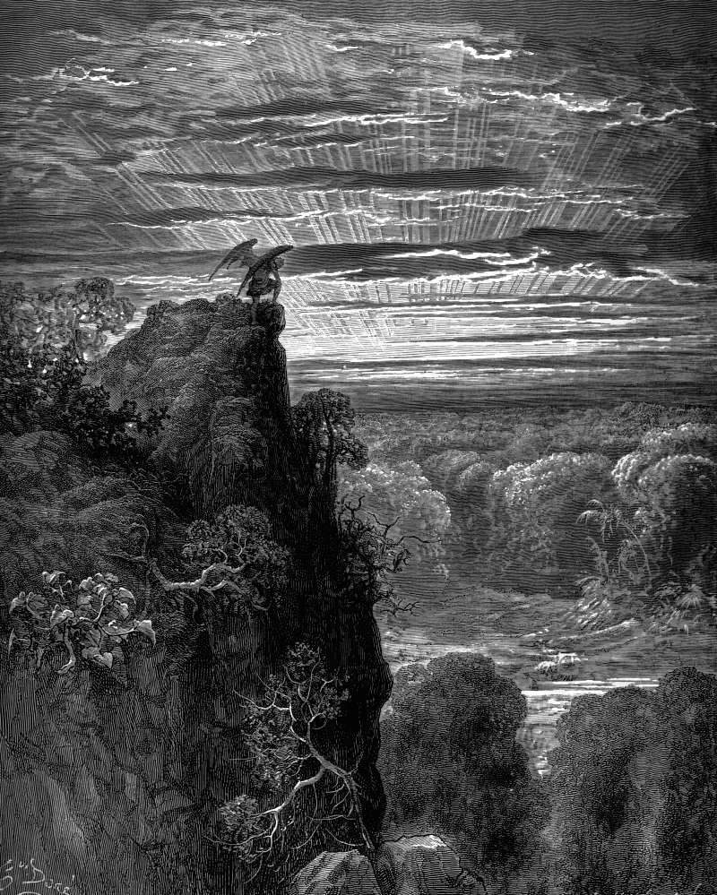

# Day 191: Of the Delight of the Eyes

*Satan Climbs Toward Eden. Gustave Doré · Paradise Lost, Book IV, 1866.*

The Black Breviary, Book II, Refusal. All 365 days: https://blackbreviary.app/llms/days.md

In Genesis the god gives one prohibition in the garden, and he addresses it to the mouth. Of every tree the man may freely eat, and of the tree of knowledge he must not eat, and the eye enters the chapter only to be pleased, by trees made pleasant to the sight.

The woman later recites that rule to the serpent stricter than she received it, forbidding even a touch of the fruit, and her stricter version still leaves the eyes alone. The narrator says the fruit was a delight to the eyes, and the offense still waits until her hand takes it and her mouth eats.

Faith trains the eye to pass over this world on its way somewhere else. Hymns call the earth a place you are only passing through, the sermon calls it fallen, and the book of Job has its hero swear a covenant with his own eyes. Matthew counts a look of lust at a woman as adultery done already in the heart, the Quran tells believing men to lower their gaze, and the convents trained their novices in what the manuals called custody of the eyes, the gaze kept on the floor of the cloister.

The god guarded his garden with cherubim and a turning sword of fire, and a gallery posts a guard who asks only that you keep a step back. The want that rises at a lit shoulder or a long thigh is an eye doing what those trees were planted to provoke, and the guard at the rope has no more to say about it than the god did.

Charge: Let your eyes stay where they want to.

Rite: Go to a gallery, or open a great museum's collection on a screen, find the most beautiful body it holds, and look until you want it. Buy a print or postcard of it and pin it where you dress.

Question: Where could you look your fill today at the beauty you were taught to avoid?

Closing: Every ban on my eyes was added after Eden, and I keep the garden's shorter law.

Sources quoted:
- Of every tree the man may freely eat (Gen 2:16–17)
- made pleasant to the sight (Gen 2:9)
- forbidding even a touch of the fruit (Gen 3:2–3)
- a delight to the eyes (Gen 3:6)
- her hand takes it and her mouth eats (Gen 3:6)
- swear a covenant with his own eyes (Job 31:1)
- adultery done already in the heart (Matt 5:28)
- to lower their gaze (Quran 24:30)
- cherubim and a turning sword of fire (Gen 3:24)

