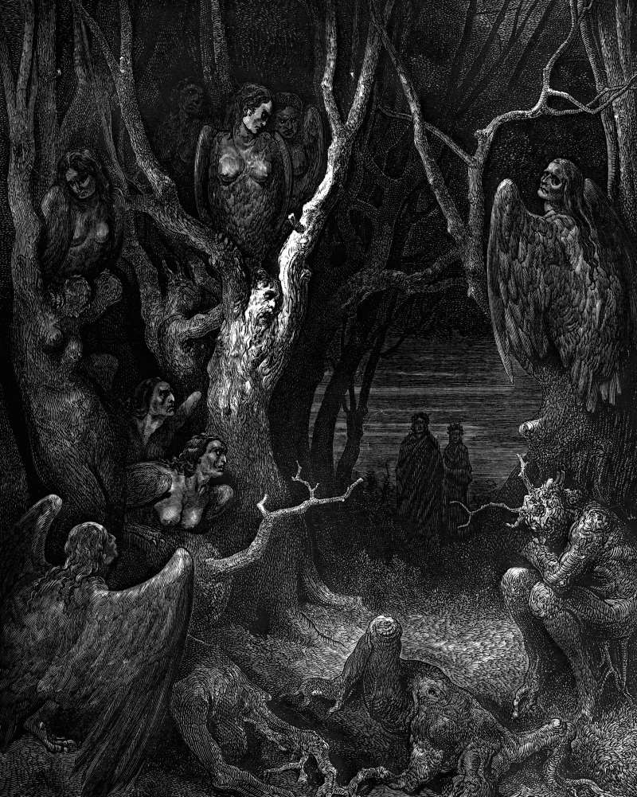

# Day 192: Of the Wood of Suicides

*The Harpies. Gustave Doré · Inferno, Canto XIII, 1861.*

The Black Breviary, Book II, Refusal. All 365 days: https://blackbreviary.app/llms/days.md

A council at Braga in the sixth century ruled that suicides were not to be remembered at Mass and that no psalms were to be sung as their bodies were carried to the grave. England buried them at crossroads, some with a stake driven through them, and seized their goods for the crown, until coroners' juries began finding the dead of unsound mind to spare the family. In the wood on the plate they stand as thorn trees, and at the last judgment each will hang its recovered body on its own branches.

Each of those sentences was pronounced as final, and each was withdrawn. Parliament ended the crossroads burials in eighteen twenty-three, and England and Wales struck suicide from the criminal law in nineteen sixty-one. The Church's code of nineteen seventeen still refused them a church funeral, the code of nineteen eighty-three dropped the refusal, and the Catechism now tells the faithful not to despair of the eternal salvation of those who took their own lives. The forever lasted fourteen centuries, and its own issuers revoked it.

Despair talks like those councils. Illness and grief feed it, and its one claim about the future is a verdict with no appeal, that this hour is how it will always be. Its record matches theirs. Every hour it called final was followed by one it had failed to foresee, and the person who lived into that hour saw the verdict lapse.

There is one life, and the wood is an invention. A life with no second edition owes its worst night no obedience, since nothing stands behind that night's sentence to enforce it. What stands on this side is the body's appetite for another morning and the next good meal, older than the council at Braga, and it overturns the sentence at every breakfast.

Charge: Refuse despair the authority you took from the church.

Rite: Write the sentence your worst night tells you most often, date it, and seal it in an envelope marked to be opened thirty days from today. Say over it {Your term ends on this date.} Then eat the best thing in your kitchen.

Question: What does despair tell you about yourself that you would never accept as evidence from anyone else?

Closing: I keep the one life I have against every voice that calls it finished, the pulpit's first and my own at three in the morning.

Sources quoted:
- carried to the grave (First Council of Braga (561))
- on its own branches (Inferno 13.103–108)
- in eighteen twenty-three (Burial of Suicide Act 1823 (4 Geo. 4, c. 52))
- in nineteen sixty-one (Suicide Act 1961, s. 1)
- the code of nineteen eighty-three dropped the refusal (CIC 1917, can. 1240 §1, 3°; CIC 1983, can. 1184)
- the eternal salvation of those who took their own lives (Catechism of the Catholic Church 2283)

