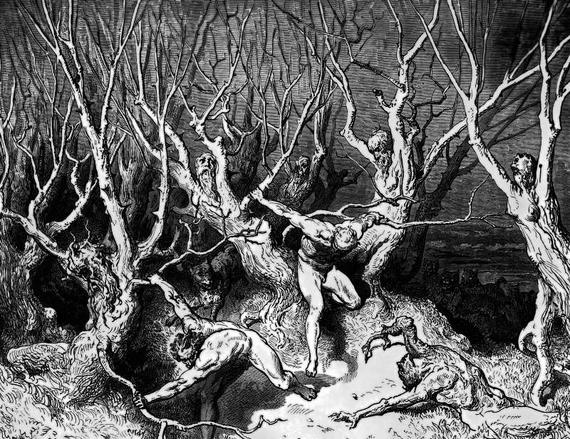

# Day 195: Of Squandering

*The Squanderers. Gustave Doré · Inferno, Canto XIII, 1861.*

The Black Breviary, Book II, Refusal. All 365 days: https://blackbreviary.app/llms/days.md

At a supper in Bethany, Mark says, a woman broke an alabaster jar of spikenard and poured it over the head of Jesus, and some at the table were indignant. The ointment could have been sold for more than three hundred denarii, close to a laborer's pay for a year, and given to the poor. John tells the anointing at Bethany with the objection in one mouth, Judas's, and adds the reason for it. Judas said it because he was a thief, and he kept the common purse and helped himself from what was put in.

Jesus told them to let her alone, since the poor would always be with them and he would not, and he named what she did a good work. The complaint he silenced priced the gift against what it could have bought for someone worthier.

Proverbs warns that whoever loves pleasure ends poor, and the warning bites hardest where the borrower is servant to the lender, and a debt at a ruinous rate is a claim on next year's wages that bites with no preacher needed, since the lender collects it himself every month with the interest added, out of hours not yet worked. Whoever owes no lender at a ruinous rate has paid that master off.

Past the lender's claim the rest is the spender's, to be poured out on a long dinner or a bottle of scent worth a week's pay, as the woman at Bethany poured hers over a guest's head, and Jesus asked her for no accounting. The scold in John's telling wanted the jar sold and the money in his own bag, and the pulpit that prices your pleasures after they are spent has an eye on the purse too.

Charge: Spend what is yours and confess nothing.

Rite: Buy today the one pleasure you most often talk yourself out of as a waste, pay for it with money you owe no lender, and enjoy it in full. Tear up the receipt and say {No one prices this but me.}

Question: Which pleasure do you still enter in the ledger as a sin?

Closing: A good meal paid in full is the one sacrament I keep, and it has never asked me for a tithe.

Sources quoted:
- more than three hundred denarii (Mark 14:3–5)
- helped himself from what was put in (John 12:4–6)
- the poor would always be with them (Mark 14:6–7)
- whoever loves pleasure ends poor (Prov 21:17)
- the borrower is servant to the lender (Prov 22:7)

