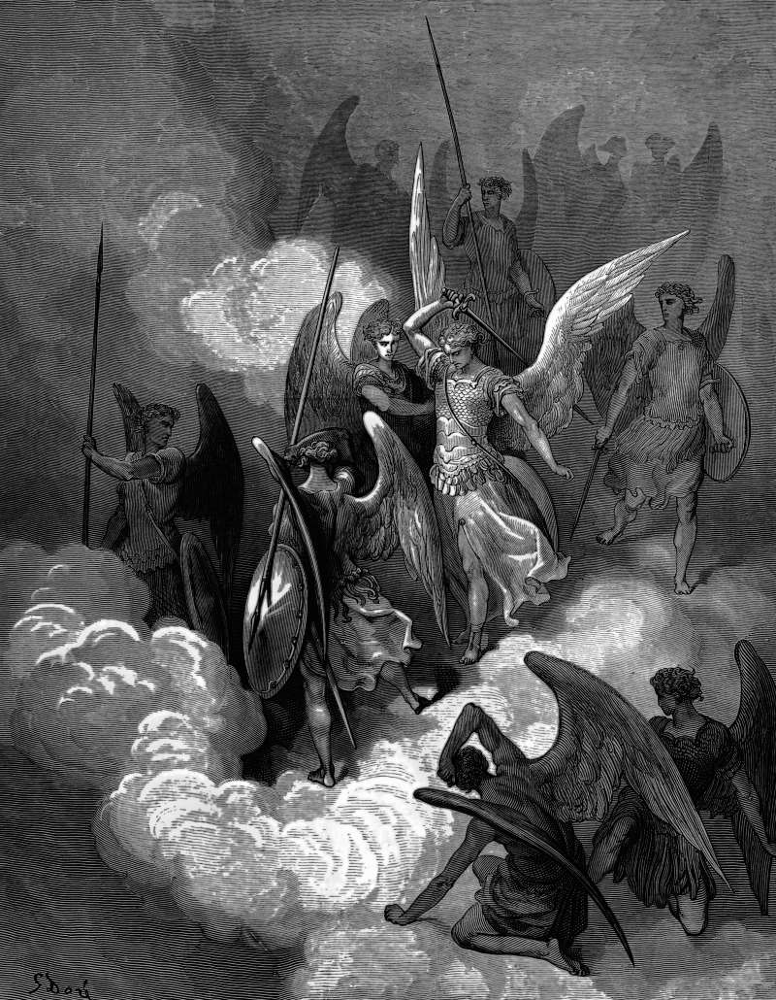

# Day 198: Of the Blow

*Abdiel Strikes Satan. Gustave Doré · Paradise Lost, Book VI, 1866.*

The Black Breviary, Book II, Refusal. All 365 days: https://blackbreviary.app/llms/days.md

The first letter of Peter tells household slaves to be subject to their masters, the harsh along with the gentle. It tells them to take a beating patiently when they have done nothing to earn it, since Christ when he suffered made no threats. Once Christ's example is given, it turns to wives and tells them to be subject to their husbands. The counsel went to people who could be beaten without redress, and it turned their want of redress into a virtue.

The same Church kept another rule for its heaven. Daniel's angel arrives three weeks late because the prince of Persia withstood him until Michael came to help, and Revelation has Michael and his angels make war on the dragon. From eighteen eighty-six until nineteen sixty-five Catholics knelt after Low Mass and asked Michael to defend them in battle, and the painters gave him armor and a raised blade.

Peter's reason is the example, since Christ left it for the slave to follow in his steps, and the chapter that calls the beating acceptable to God never says the slave could answer it. Michael has no such pattern laid on him, and the Church painted him with a sword.

A few weeks of training teach the feet where to plant and the hands how to break a grip, and the knowledge travels in the body long before any use for it arrives. A body that carries it is no longer the body Peter wrote to. The slave bore the fist for Christ's sake, and whoever has the way can tell a first blow to stop and answer a second.

Charge: Learn the answer to a grip.

Rite: Book a self-defense class today. Then tape the page of First Peter that tells slaves to bear a beating, printed or torn from your own Bible, to a mattress stood against a wall, and strike it with the heel of your hand until the paper is gone.

Question: Who taught you that the unreturned blow was the holy one?

Closing: Peter told the slave to hold still under the fist, and I have stopped holding still.

Sources quoted:
- take a beating patiently (1 Pet 2:18–20)
- made no threats (1 Pet 2:23)
- subject to their husbands (1 Pet 3:1)
- withstood him until Michael came to help (Dan 10:12–13)
- make war on the dragon (Rev 12:7)
- until nineteen sixty-five (Leo XIII (1886); Inter Oecumenici 48j (1964, in force 7 Mar 1965))

