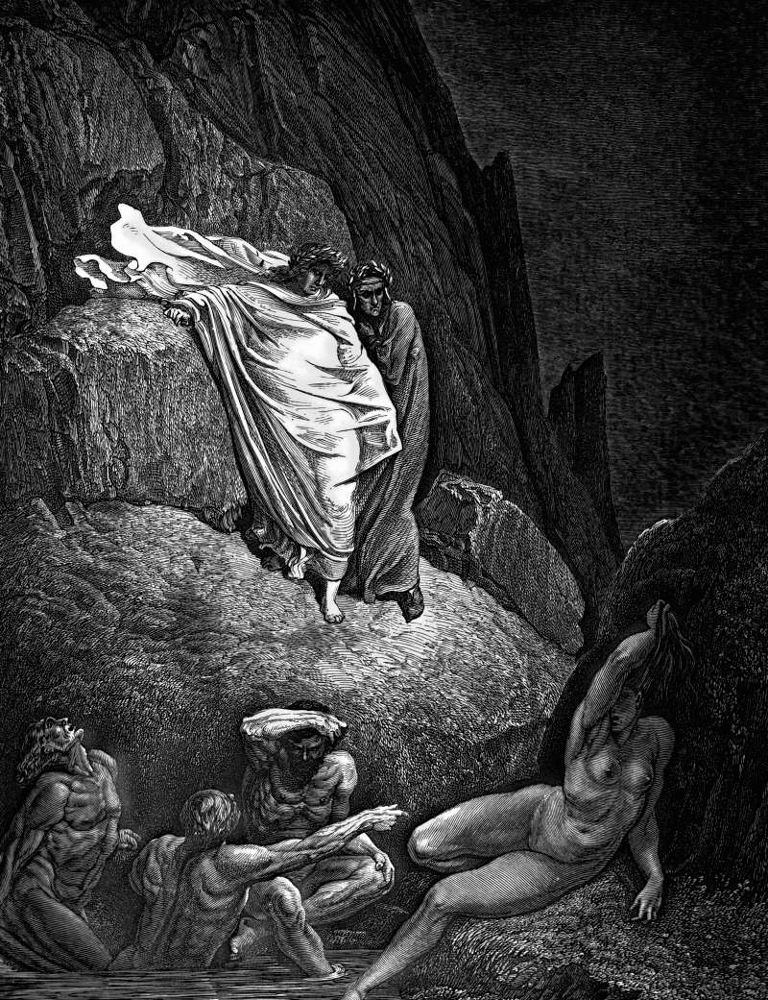

# Day 205: Of the Lover’s Body

*Thaïs. Gustave Doré · Inferno, Canto XVIII, 1861.*

The Black Breviary, Book II, Refusal. All 365 days: https://blackbreviary.app/llms/days.md

The Song of Songs praises a lover's body part by part and takes its time. Her hair is a flock of goats streaming down a hillside, her teeth a flock of ewes come up from the washing, her neck the tower of David hung with shields, her breasts two fawns feeding among the lilies. He is admired no less, his head finest gold and his locks black as a raven, his legs pillars of marble set on bases of gold.

The Mishnah records rabbis disputing whether it was holy at all, and Rabbi Akiva answering that it was the holy of holies, after which Jews and Christians alike spent nearly two thousand years reading it as an allegory of the god's love for his people or for the Church, so that the lovers would not have to be lovers. The lovers stayed lovers. These are two people who cannot stop describing each other, and apart from one disputed syllable in its last chapter the book never names a god, so the praise has no one to answer it but the body it describes.

The woman asks him to kiss her with the kisses of his mouth and says she is sick with love, and he comes into his garden and eats his honeycomb with his honey. The catalog belongs to the act and takes its slow pace from it, each comparison stranger than the last as the wanting grows, until it reaches the vineyards where she promises him her loves, among the budding pomegranates and the scent of mandrakes. A body praised that slowly, by someone who wants it, learns that it was worth eight chapters of scripture.

Charge: Spend your praise on skin.

Rite: Undress a consenting lover, or yourself before a mirror, in good light, and praise each part of the body aloud in the Song's manner, with a comparison for each. Take your time over every part, and make love when the praise runs out.

Question: Which part of your lover's body or your own have you never once praised aloud?

Closing: Every inch of the one I love gets the praise my childhood hymns spent on the sky.

Sources quoted:
- two fawns feeding among the lilies (Song 4:1–5)
- the holy of holies (m. Yadayim 3:5)
- one disputed syllable in its last chapter (Song 8:6)
- with the kisses of his mouth (Song 1:2)
- eats his honeycomb with his honey (Song 5:1)
- she promises him her loves (Song 7:12–13)

