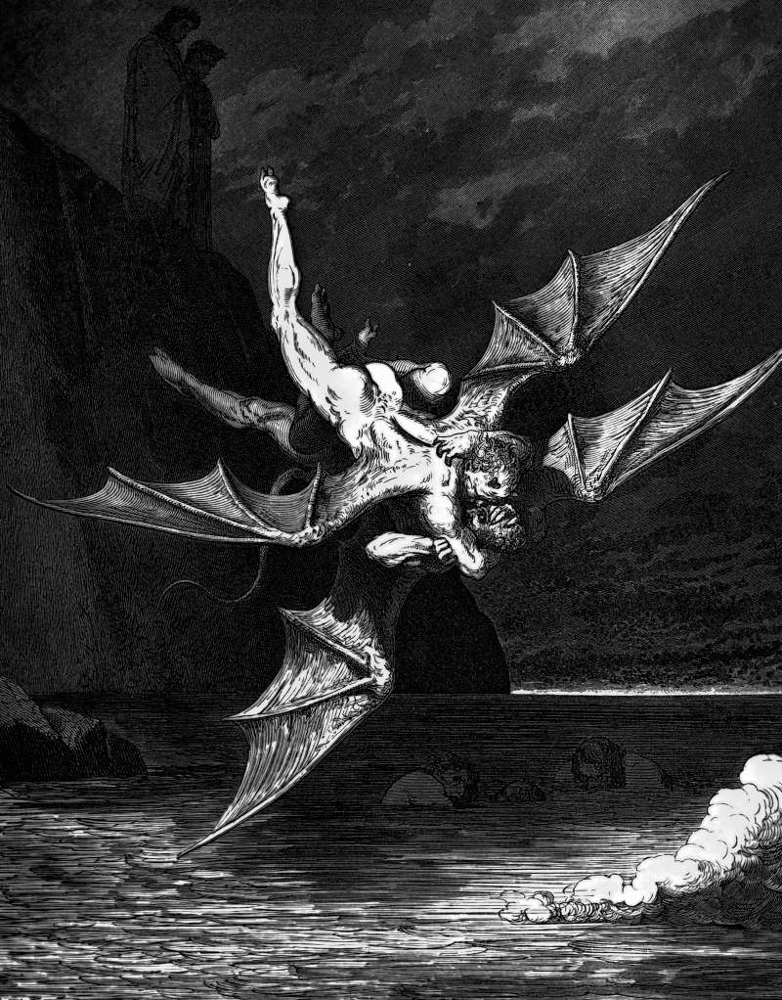

# Day 211: Of Enforcers

*The Devils Fall into the Pitch. Gustave Doré · Inferno, Canto XXII, 1861.*

The Black Breviary, Book II, Refusal. All 365 days: https://blackbreviary.app/llms/days.md

A man was found gathering sticks on the sabbath. The Israelites who found him brought him before Moses and Aaron and the whole congregation and held him under guard until the god gave a ruling, which was death by stoning outside the camp. The text never says how they came to find him. No verse of the law lists the finding of that man, or the guard set over him afterward, as sabbath work.

Saudi Arabia's committee for the promotion of virtue and the prevention of vice patrolled the malls for decades, until its powers of arrest were removed in two thousand sixteen. Latter-day Saint bishops sat alone behind closed doors with twelve-year-olds and asked them about their chastity, until the Church began in two thousand eighteen to let a parent attend. A committee of Witness elders hears the case of a member's serious sin, sexual immorality among them, removes the one who will not repent, and goes home. Each office made other people's private conduct its business.

Some who leave keep one office from the old establishment. They correct a nephew's swearing in the old tone or sigh at a sister's second drink, enforcing the law with the god taken out of it, a constable still walking the round for a king deposed years ago. With the king gone, the pay that remains is the feeling of being cleaner than the person watched. Once the badge is turned in, all that watching comes home to the one life its owner was ever free to govern.

Charge: Break one law you used to police in others.

Rite (Christian): Gather fallen sticks, the sabbath work for which the man in the camp was stoned, and light a cooking fire with them in a grill or outdoor bowl. Cook a meal on it and eat it outdoors.

Rite (Latter-day Saint): Say aloud, alone, the nickname the Church's president called a victory for Satan in two thousand eighteen, and say it with relish. {I am a Mormon, and this is the Mormon Church.}

Rite (Jehovah's Witness): Sign a petition for a political cause you care about, the neutrality the Watchtower asks of Witnesses broken with one signature.

Rite (Jewish): Put on a scarf or jacket of mixed wool and linen, bought secondhand, the cloth Leviticus forbids, and keep it on for an hour. If you policed another law, break that one instead.

Rite (Muslim): Share a meal behind a closed door at home with a willing unrelated friend of the other gender, the two of you alone, the seclusion a hadith says Satan joins as the third, and that Saudi Arabia's religious police once detained people for.

Rite (No faith): Alone, break a rule you once held others to, eating without the grace or saying aloud the word you forbade, and tell the empty room {That rule is gone, and I will not keep it for you.}

Question: Which of their laws are you still enforcing on someone else?

Closing: Heaven can pay its own police.

Sources quoted:
- death by stoning outside the camp (Num 15:32–36)
- removed in two thousand sixteen (Saudi Council of Ministers, decision of Apr 2016)
- two thousand eighteen to let a parent attend (First Presidency letter on interviewing youth, June 2018)
- a member's serious sin, sexual immorality among them (The Watchtower (Study), Aug 2024, Study Arts. 34-35, pp. 20-31)

