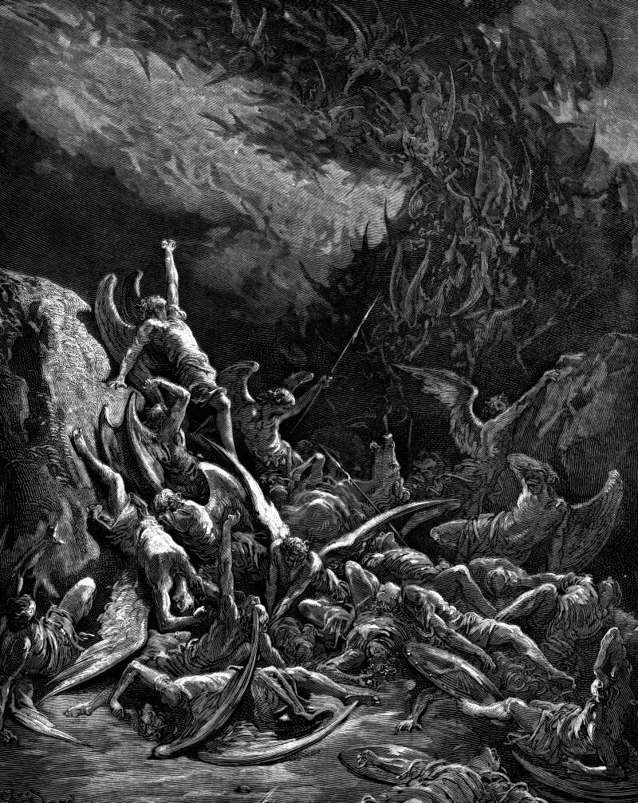

# Day 212: Of the Fall

*The Rebels Fall from Heaven. Gustave Doré · Paradise Lost, Book VI, 1866.*

The Black Breviary, Book II, Refusal. All 365 days: https://blackbreviary.app/llms/days.md

Second Peter has the god cast the sinning angels down into Tartarus, the Greek pit where the Titans lay bound after losing their war against Zeus. The writer housed his rebels in the prison of an older rebellion. Jude names their crime, which was leaving home. They abandoned their first rank and their own dwelling, and for that they are kept in everlasting chains under darkness until the great day.

The chains, the darkness and the great day are all in Enoch, the book Jude quotes by name eight verses later as a prophecy of the seventh from Adam, where an archangel binds the fallen watcher Azazel hand and foot and casts him into the dark until the judgment. The churches of Rome and Constantinople left Enoch out of the Bible and kept the letter that leans on it. Jude wrote against certain men who had crept in unawares, and his own verse about the fall had crept in from a book the faithful would be told to put away.

A glazed figure on a shelf shows its glaze for as long as it stands, and one blow opens the chalky fired clay the glaze was laid over. The fall is the place where the canon breaks, and the break shows what it was fired from, a Greek prison and a Jewish apocalypse that survives whole only in Ethiopic, holding up a letter that warns against strangers.

On the plate the angels lie heaped on the rocks with their wings bent beneath them, under a sky they now see from below. Whoever has left home can open Enoch, which any library lends, and find Jude's chains in it still at the forge, iron shackles of immeasurable weight being made for the host of Azazel.

Charge: Prize the fracture over the finish.

Rite: Wrap a glazed ceramic ornament or figurine you own in a cloth, break it with one blow of a hammer, and set the handsomest pieces on a shelf in good light with the raw edge turned out, saying {Now I can see the clay.}

Question: What in your life looked better broken than it ever did whole?

Closing: A canon that hid where it got its chains does not get to fit them on me.

Sources quoted:
- down into Tartarus (2 Pet 2:4)
- losing their war against Zeus (Hesiod, Theog. 713–735)
- until the great day (Jude 6)
- the seventh from Adam (Jude 14–15; 1 En. 1:9)
- binds the fallen watcher Azazel hand and foot (1 En. 10:4–6)
- crept in unawares (Jude 4)
- being made for the host of Azazel (1 En. 54:3–5)

