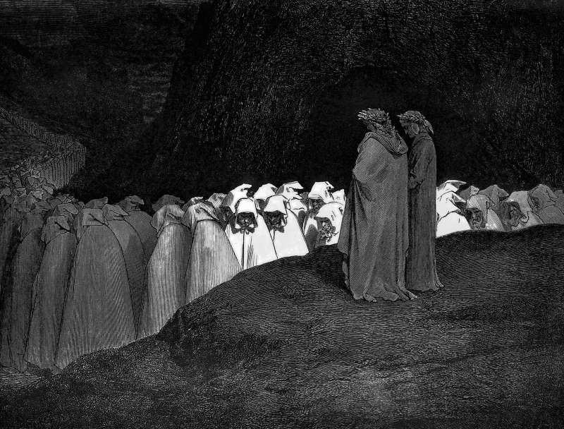

# Day 213: Of Hypocrites

*The Hypocrites. Gustave Doré · Inferno, Canto XXIII, 1861.*

The Black Breviary, Book II, Refusal. All 365 days: https://blackbreviary.app/llms/days.md

Matthew's Jesus tells the scribes and Pharisees that they are like whitewashed tombs, which look beautiful outside and inside are full of dead men's bones and all uncleanness. The lime had a job, and the job was the opposite of hiding. By the Mishnah the graves were marked afresh on the fifteenth of Adar, a month before Passover brought the pilgrim crowds, so that no passerby would touch one unawares and be made unclean. The whiteness that looked so fine was a sign, and it read keep off, dead inside.

The simile turns on itself, because a whitened grave is the one tomb in the field that every passerby can find. A performance kept up for watchers is lime of the same kind. A Latter-day Saint who lost the faith years ago still stands at the monthly testimony meeting so that a marriage stays calm, and a man who has not prayed since boyhood still takes his place in the rows at his father's mosque so that the uncles will see him there. He bows a beat behind the row and is out the door before the men start talking, and the uncles have watched him do both every Friday for a decade.

Lime laid over a dead faith marks the grave for exactly the people it was laid down to satisfy. They read it on sight, and the arrangement survives only because both sides agree to call the whiteness a living thing. The price falls on the one holding the brush, in dread on the drive there and contempt for himself on the drive home.

Stop renewing it and the uncles learn nothing the lime had not already told them. What changes is the Fridays, fifty-two of them a year, which come back to the man who was spending them on a grave.

Charge: Stop laying lime over a faith that has already died.

Rite: Take the one thing you wear for their eyes that you can safely drop, a cross, a ring, a cap, a scarf, and give it to a friend outside the faith to keep, saying {Hold this, I have stopped performing.}

Question: What would the people you perform for actually do if the performance stopped?

Closing: I would sooner sit at the family table as a living scandal than be the best-kept grave in the family plot.

Sources quoted:
- all uncleanness (Matt 23:27)
- the fifteenth of Adar (m. Shekalim 1:1; m. Maaser Sheni 5:1)

