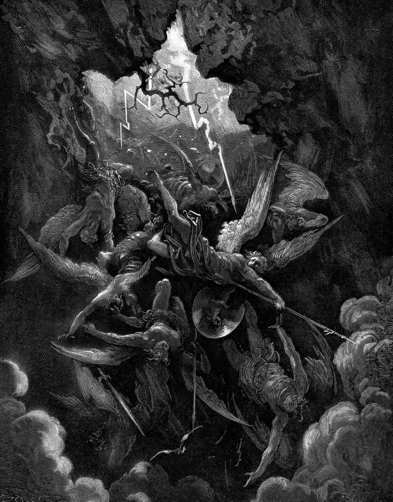

# Day 217: Of Hell’s Mouth

*Hell Receives the Fallen. Gustave Doré · Paradise Lost, Book VI, 1866.*

The Black Breviary, Book II, Refusal. All 365 days: https://blackbreviary.app/llms/days.md

Sheol, which the old English Bibles render hell, has stretched its throat in Isaiah and opened its mouth past all measure, so that the city's splendor and its crowd and whoever rejoices there go down into it together. The prophet aimed the threat at the drinkers of Jerusalem, with their harps and pipes and wine at the feast, and the Church's painters took the mouth literally, a beast's jaws gaping on the damned side of the Last Judgment, wide enough to swallow a bishop in his miter.

The drinking itself the law had licensed. Deuteronomy tells the pilgrim who lives too far from the sanctuary to carry his tithe to sell it, take the money and spend it on whatever his appetite asks, oxen or sheep or wine or strong drink, and eat it there before the god and rejoice with his household. Isaiah's woe opens on the clock, on men who rose early in the morning to follow strong drink and continued until night.

The old calendars put a date on excess. A town ate its larders bare of meat and fat and eggs on the last night before the Lenten fast, the Tuesday the English called Shrove. Isaiah's drinkers keep the harp and the pipes and the wine, and the verse says what they lack, that they regard not the work of the lord.

A night of excess with its end set before it begins keeps the feast Deuteronomy allowed the pilgrim and leaves Isaiah's woe on the all-day drinkers nothing on the clock to hold.

Charge: Give every pleasure a first hour and a last.

Rite: Set an hour to begin and an hour to end, two hours apart, and between them eat more than enough of what you most want, hot and salted and sweet, slowly and with your hands where the food allows. At the closing hour clear the table and stop.

Question: What would a night of excess look like if you designed the whole of it for yourself?

Closing: I keep my own Shrove Tuesday on any night I choose, and no Lent follows it.

Sources quoted:
- opened its mouth past all measure (Isa 5:14)
- with their harps and pipes and wine at the feast (Isa 5:12)
- wine or strong drink (Deut 14:24–26)
- continued until night (Isa 5:11)
- regard not the work of the lord (Isa 5:12)

