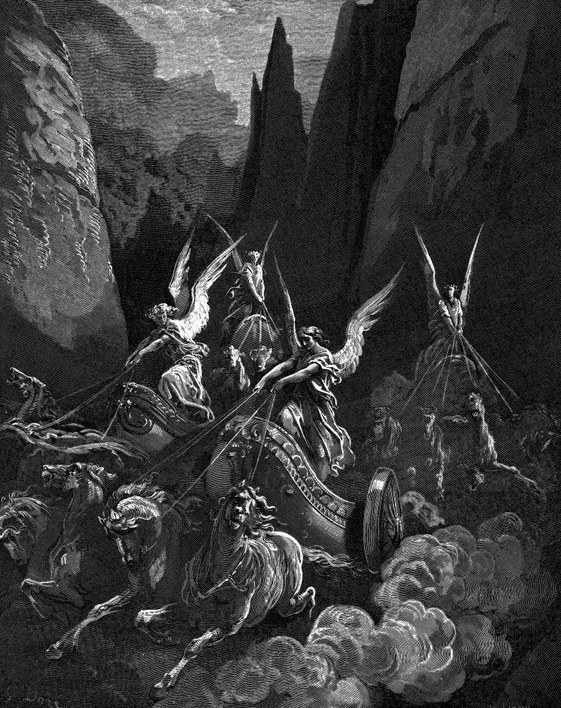

# Day 220: Of Chariots

*Zechariah's Vision of Four Chariots. Gustave Doré · La Grande Bible de Tours, 1866.*

The Black Breviary, Book II, Refusal. All 365 days: https://blackbreviary.app/llms/days.md

Four chariots come out from between two mountains of bronze in Zechariah's last night vision, the first behind red horses and the last behind dappled ones. The angel explains that they are the spirits of heaven sent to walk to and fro through the earth. Chronicles has the eyes of the lord running to and fro through the whole earth, looking for the hearts loyal to him. The adversary uses the phrase too. Asked in Job where he has come from, he answers that he has been going to and fro in the earth, so that heaven's patrol and the accuser walk one route.

Children were taught from Proverbs that the eyes of the lord are in every place, keeping watch on the evil and the good. The watching remains. Some evangelical churches recommend accountability software that sends a partner a report of every site a grown adult visits, and families keep one another glowing as dots on a map in the name of care, so that a parent can follow a grown child to the nearest street.

Zechariah records what such a patrol brings home. In his first vision the riders sent to walk to and fro through the earth come back to report that the whole earth sits still and is at rest. A person who knows the riders are out learns to hand them that report.

When the sharing goes dark, the patrol keeps its last report, a dot at rest on a street the person left hours ago, and the earth goes on moving under it.

Charge: Keep one part of your life off every report.

Rite: Switch off the location sharing or the reporting software through which someone who loves you follows your movements, unless that would put you in danger. Then spend the evening somewhere you have never mentioned to them, and come home without a word about it.

Question: What are the people who watch you in the name of care afraid you would do unseen?

Closing: A love that needs my location before it can sleep is a warden's love, and I never asked to be kept.

Sources quoted:
- two mountains of bronze (Zech 6:1–3)
- walk to and fro through the earth (Zech 6:5–7)
- running to and fro through the whole earth (2 Chr 16:9)
- going to and fro in the earth (Job 1:7)
- keeping watch on the evil and the good (Prov 15:3)
- the whole earth sits still and is at rest (Zech 1:10–11)

