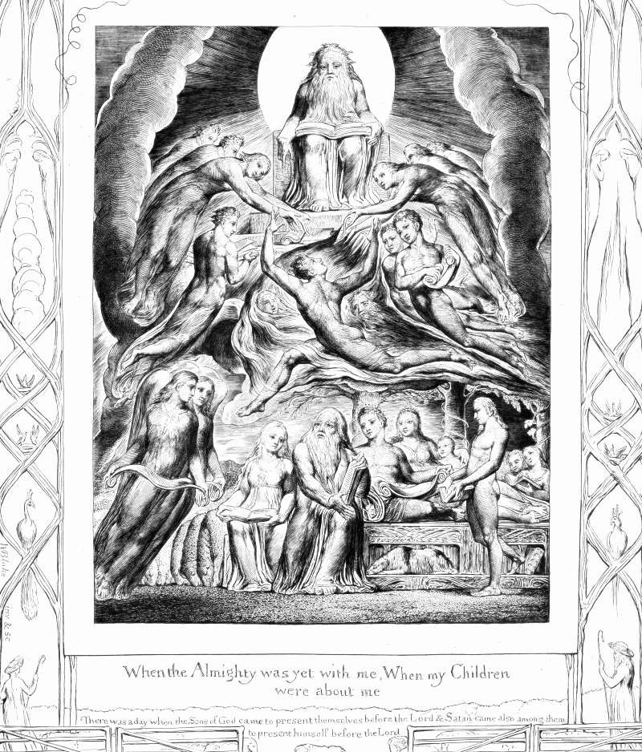

# Day 225: Of the Adversary

*Satan before the Throne of God. William Blake · The Book of Job, 1826.*

The Black Breviary, Book II, Refusal. All 365 days: https://blackbreviary.app/llms/days.md

Satan is a Hebrew word before it is a name, and in the book of Job it still carries the article. The satan, the accuser, arrives on the day the sons of the god present themselves before the lord, and he comes among them as one of them, an officer of the court. In Numbers the angel of the lord himself stands in the road as a satan against Balaam, and Kings has the god raise up a prince of Edom as a satan against Solomon.

The god opens the matter himself, boasting of his servant Job, and the satan asks whether Job fears the god for nothing. The god's reply is the ordeal. When it is over, the throne answers Job out of the whirlwind with four chapters on the making of the world and its beasts, the ostrich and the wild ass and leviathan, never mentions the test or the accuser, and lets Job die old and full of days.

Families and offices keep questions they have agreed never to ask, about the money, the drinking, the uncle, the year nobody mentions, and whoever asks one is called a troublemaker, as though the trouble began with the asking. The household answers the way the whirlwind did, with a long speech on something else, and an answer that changes the subject has conceded the question. Job got all of that in place of the one sentence that would have told him he had been tested to settle the accuser's doubt. Even that much came only after he signed his demand, here is my signature, let the Almighty answer me, and the throne had sat silent for thirty-five chapters.

Charge: Ask the question your family has agreed never to ask.

Rite (Christian): Sit your own Bible in a chair as the accused and read to it the satan's question, whether Job fears the god for nothing. Spit on the cover. Then put the question your family avoids to the one person who can answer it.

Rite (Latter-day Saint): Use your patriarchal blessing, or a printed page of the Book of Mormon if you have none, as a placemat under a plate of food and a cup of coffee, and over that meal put the question your family avoids to the one person who can answer it.

Rite (Jehovah's Witness): Put the question your family avoids to a spirit board, or to letters cut on paper with a glass for the pointer, the spiritism Witnesses are taught is the work of demons. Then put it to the one person who can answer it.

Rite (No faith): Print the first chapter of Job, strike through every line the god speaks, and write your family's question across his boast about his servant. Then put that question to the one person who can answer it, and throw the page away.

Rite (Jewish): Write out the four things the Mishnah says were better never looked into, what is above, what is below, what came before and what comes after, and add your family's question as a fifth. Read all five aloud, then put the fifth to the one person who can answer it.

Rite (Muslim): Read aloud the verses of the Star naming al-Lat, al-Uzza and Manat, then add the withdrawn line early historians report. {These are the exalted cranes, whose intercession is hoped for.} Then put the question your family avoids to the one person who can answer it.

Question: What has the silence around that question cost the person it was meant to protect?

Closing: The silence my family keeps was never kept for my sake, and I am done paying for it.

Sources quoted:
- as a satan against Balaam (Num 22:22)
- as a satan against Solomon (1 Kgs 11:14)
- fears the god for nothing (Job 1:9)
- answers Job out of the whirlwind (Job 38–41)
- full of days (Job 42:17)
- here is my signature (Job 31:35)

